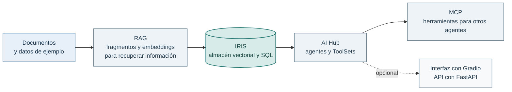

  

# Desarrollo de asistentes de IA con RAG, agentes y MCP

  <strong>Un curso práctico sobre InterSystems IRIS y AI Hub.</strong> 
  Aprende a crear asistentes que consultan documentos y datos de IRIS y utilizan herramientas mediante MCP.

En este curso construirás asistentes que buscan información en documentos y datos de IRIS, indican de dónde la obtienen y utilizan herramientas con permisos definidos. Aprenderás a evaluar sus resultados y a reconocer cuándo les falta información para responder. Al terminar tendrás un sistema RAG con almacenamiento en IRIS, un agente AI Hub y un servidor MCP para que otros agentes puedan consultar las mismas herramientas.

## Lo que vas a aprender

- Construir un RAG que consulte documentos y responda indicando las fuentes utilizadas.
- Almacenar embeddings en IRIS y realizar búsquedas vectoriales con SQL y un índice HNSW.
- Comprobar qué información recupera el asistente, si las fuentes respaldan su respuesta y cuándo debe reconocer que no puede responder.
- Crear agentes AI Hub con sesiones, ToolSets y políticas de autorización.
- Publicar herramientas mediante MCP para que otros agentes puedan utilizarlas.

Los ejercicios utilizan una tienda ficticia con pedidos, catálogo, envíos y políticas de soporte. Los datos son sintéticos y el repositorio no incluye credenciales.

## Requisitos

- Docker Desktop, si preparas el entorno en tu equipo.
- Python 3.11, 3.12 o 3.13 en la máquina donde ejecutes los labs.
- Visual Studio Code con las extensiones **Python**, **Jupyter** e **InterSystems ObjectScript**.

VS Code es el entorno recomendado: abre los notebooks y selecciona `.venv` como intérprete y kernel. Para ObjectScript puedes abrir una sesión directamente con **InterSystems Lite Terminal**. También puedes abrir la sesión desde la terminal con los comandos que se indican en los labs.

## Inicio rápido

Si el instructor te ha asignado una máquina AWS, empieza por la [guía de acceso del alumno](docs/guia-acceso-aws-alumno.md) para conectarte desde VS Code y configurar tu clave de OpenRouter.

Empieza por el [Lab 00 · Preparar el entorno](labs/00-setup/README.md). Allí se distingue entre una máquina facilitada por el instructor y una instalación en tu equipo. Prepararás `.env`, Docker, Python y los datos de ejemplo una sola vez para todo el curso.

Si ya tienes el entorno listo, pasa al Lab 01. Cada lab indica sus requisitos y la preparación adicional que necesita. No necesitas reinstalar las dependencias base. Los comandos se ejecutan desde la raíz del repositorio, en la máquina donde está el entorno del curso.

Para generar respuestas se utiliza OpenRouter con GPT-OSS 20B por defecto. Antes de empezar, sigue las [instrucciones para configurar tu clave](docs/guia-acceso-aws-alumno.md#4-añade-tu-clave-y-arranca-iris). Los embeddings se calculan localmente y las pruebas que no llaman al modelo pueden ejecutarse sin esa clave.

## Recorrido del curso

Sigue los labs en este orden. En los Labs 01–03 puedes usar el notebook para avanzar paso a paso o ejecutar el script desde la terminal. Ambos realizan las mismas operaciones. En los Labs 04–06 trabajarás directamente con las clases ObjectScript de AI Hub.

Puedes elegir notebook o script. No es obligatorio ejecutar ambos. Si los combinas, conserva lo ya preparado: en el Lab 02 la tabla y el índice se crean una sola vez.

| Lab | Qué vas a practicar |
| --- | --- |
| [00 · Preparar el entorno](labs/00-setup/README.md) | Configuración, carga de datos de ejemplo y comprobación inicial. |
| [01 · RAG local](labs/01-python-rag-basico/README.md) | Lectura de documentos Markdown, división en fragmentos, embeddings y búsqueda en memoria. Generación opcional de respuestas. |
| [02 · Búsqueda vectorial en IRIS](labs/02-sql-vector-search/README.md) | Almacenamiento de los embeddings y búsqueda con SQL y HNSW. |
| [03 · Evaluar el RAG](labs/03-python-rag-evaluable/README.md) | Pruebas de recuperación de información, referencias a las fuentes y abstención. |
| [04 · IRIS y AI Hub](labs/04-iris-y-aihub/README.md) | Agente, sesiones, herramientas y política. |
| [05 · AI Hub + RAG](labs/05-aihub-rag/README.md) | Consulta de políticas desde el agente y seguimiento de sus llamadas a herramientas. |
| [06 · AI Hub y MCP](labs/06-aihub-mcp/README.md) | Publicación de las herramientas de IRIS en un servidor MCP. |

## Ampliaciones opcionales

Puedes hacerlas después de los labs que se indican en cada una. No son necesarias para completar el recorrido principal.

- [LangChain](labs/opcionales/langchain/README.md): notebook con un ejemplo completo para comparar el RAG del curso con una implementación basada en LangChain.
- [Text-to-SQL](labs/opcionales/text-to-sql/README.md): agente AI Hub que genera consultas `SELECT` sobre cuatro tablas de ejemplo.
- [Config Store y Wallet](labs/opcionales/config-store-wallet/README.md): configuración del agente y credenciales protegidas en IRIS.
- [Interfaz del asistente](labs/opcionales/ui-asistente/README.md): una interfaz con Gradio y una API con FastAPI para el RAG de Python.

Para el trabajo final, parte de [la plantilla de proyecto](plantillas-proyecto/proyecto-asistente/README.md) y consulta los [criterios de evaluación](docs/criterios-proyecto.md).

## Conceptos principales

- **Chunking:** dividir un documento en fragmentos que se puedan buscar y usar como fuente de una respuesta.
- **Embedding:** representación numérica de un texto que permite buscar otros textos de significado similar.
- **RAG:** buscar información relevante y proporcionársela al modelo para que elabore una respuesta basada en ella.
- **Abstención:** reconocer que falta información suficiente para responder.
- **ToolSet y política:** qué acciones puede ofrecer un agente y cuáles tiene autorización para ejecutar.

## Problemas habituales

- **IRIS no responde:** ejecuta `docker compose ps` y espera a que `iris-aihub` esté en ejecución.
- **El notebook no encuentra paquetes:** activa `.venv`, instala `requirements.txt` y selecciona ese kernel en VS Code.
- **No hay respuesta generada:** la recuperación local funciona sin clave. Para OpenRouter configura `OPENROUTER_API_KEY` en `.env` y recrea el contenedor cuando el lab use AI Hub.
- **El Lab 03 no encuentra corpus:** prepara primero el Lab 02 con `--initialize --load`.

## Límites de seguridad

Los ejemplos son docentes. Las herramientas del recorrido base son de solo lectura y el ejemplo Text-to-SQL permite únicamente consultas `SELECT` sobre las cuatro tablas de ejemplo. No copies estas configuraciones como política de producción sin revisarlas, no pongas secretos en Git y no pruebes con datos reales.

La imagen del laboratorio es `docker.iscinternal.com/docker-intersystems/intersystems/iris-community:2027.1.0AI.109.0`. La configuración actual utiliza OpenRouter en todo el curso, con GPT-OSS 20B por defecto.
