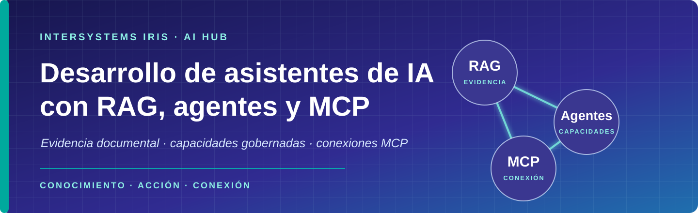
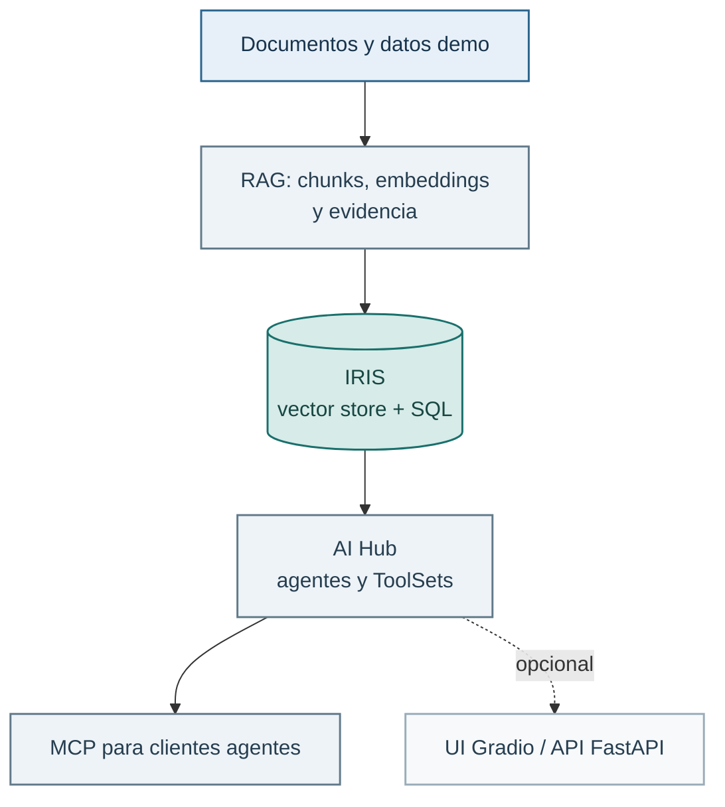

  

# Desarrollo de asistentes de IA con RAG, agentes y MCP

  <strong>Un curso práctico sobre InterSystems IRIS y AI Hub.</strong> 
  De la evidencia documental a asistentes que consultan capacidades autorizadas y conectan herramientas con MCP.

Este curso enseña a construir asistentes que no solo responden: recuperan evidencia, muestran su procedencia, se evalúan y respetan límites claros. Terminarás con un RAG persistente en IRIS, un agente AI Hub con herramientas gobernadas y un servidor MCP que otro agente puede usar.

## Lo que vas a aprender

- Recorrer un RAG desde los documentos hasta una respuesta con citas.
- Persistir embeddings y buscar con SQL e índice HNSW en IRIS.
- Evaluar recuperación, citas y abstención como pruebas reproducibles.
- Crear agentes AI Hub con sesiones, ToolSets y políticas de autorización.
- Exponer herramientas mediante MCP y comprender cómo las consume un cliente agente.

El dominio es una tienda demo: pedidos, catálogo, envíos y políticas de soporte. No hay datos reales ni secretos versionados.

## Requisitos

- Docker Desktop, si preparas el entorno en tu equipo.
- Python 3.11, 3.12 o 3.13 en la máquina donde ejecutes los labs.
- Visual Studio Code con las extensiones **Python**, **Jupyter** e **InterSystems ObjectScript**.

VS Code es el entorno recomendado: abre los notebooks y selecciona `.venv` como intérprete y kernel. Para ObjectScript puedes abrir una sesión directamente con **InterSystems Lite Terminal**. La terminal normal sigue siendo la ruta compacta y reproducible.

## Inicio rápido

Si el instructor te ha asignado una máquina AWS, empieza por la
[guía de acceso del alumno](docs/guia-acceso-aws-alumno.md) para conectar con
VS Code y configurar tu clave OpenRouter.

Empieza por el [Lab 00 · Preparar el entorno](labs/00-setup/README.md).
Allí se distingue entre una máquina facilitada por el instructor y una
instalación en tu equipo. La configuración de `.env`, Docker, Python y los
datos demo se prepara una vez y se reutiliza durante el curso.

Si ya tienes el entorno listo, pasa al Lab 01. Cada lab indica sus requisitos
y qué preparación nueva añade. No necesitas reinstalar las dependencias base.
Los comandos se ejecutan desde la raíz del repositorio, en la máquina donde
está el entorno del curso.

La generación usa OpenRouter con GPT-OSS 20B por defecto. Configúralo una vez
siguiendo [la configuración de la clave](docs/guia-acceso-aws-alumno.md#4-añade-tu-clave-y-arranca-iris) cuando vayas a generar
respuestas. Los embeddings son locales y las comprobaciones sin LLM no
necesitan esa clave.

## Recorrido base

Sigue los labs en este orden. En los Labs 01–03 el notebook es el recorrido para aprender paso a paso. El script de terminal repite el mismo flujo de forma compacta. Los Labs 04–06 se trabajan directamente en ObjectScript porque ahí vive AI Hub.

Puedes elegir notebook o script. No es obligatorio ejecutar ambos. Si los
combinas, conserva lo ya preparado: en el Lab 02 la tabla y el índice se crean
una sola vez.

| Lab | Construyes y compruebas |
| --- | --- |
| [00 · Setup](labs/00-setup/README.md) | Entorno, datos demo y smoke test. |
| [01 · RAG local](labs/01-python-rag-basico/README.md) | Markdown → chunks → embeddings → búsqueda en memoria → RAG opcional. |
| [02 · Vector search en IRIS](labs/02-sql-vector-search/README.md) | El mismo RAG, ahora persistente con SQL y HNSW. |
| [03 · Evaluar el RAG](labs/03-python-rag-evaluable/README.md) | Casos de recuperación, citas y abstención. |
| [04 · IRIS y AI Hub](labs/04-iris-y-aihub/README.md) | Agente, sesiones, herramientas y política. |
| [05 · AI Hub + RAG](labs/05-aihub-rag/README.md) | Agente con conocimiento y trazas de herramientas. |
| [06 · AI Hub MCP](labs/06-aihub-mcp/README.md) | ToolSets disponibles para clientes MCP. |

## Ampliaciones opcionales

Están fuera de la numeración y no bloquean el recorrido base.

- [LangChain](labs/opcionales/langchain/README.md): notebook autocontenido para comparar el flujo RAG con un framework.
- [Text-to-SQL](labs/opcionales/text-to-sql/README.md): agente AI Hub limitado a cuatro tablas demo y a `SELECT`.
- [UI de asistente](labs/opcionales/ui-asistente/README.md): Gradio y FastAPI sobre el RAG Python.

Para el trabajo final, parte de [la plantilla de proyecto](plantillas-proyecto/proyecto-asistente/README.md) y consulta los [criterios de evaluación](docs/criterios-proyecto.md).

## Ideas clave, sin misterio

- **Chunking:** dividir una fuente en fragmentos manejables y citables.
- **Embedding:** representación numérica para comparar significado, no palabras exactas.
- **RAG:** recuperar evidencia y entregársela al modelo como contexto explícito.
- **Abstención:** no responder cuando la evidencia no alcanza el umbral.
- **ToolSet y política:** qué acciones puede ofrecer un agente y cuáles tiene autorización para ejecutar.

## Problemas habituales

- **IRIS no responde:** ejecuta `docker compose ps` y espera a que `iris-aihub` esté en ejecución.
- **El notebook no encuentra paquetes:** activa `.venv`, instala `requirements.txt` y selecciona ese kernel en VS Code.
- **No hay respuesta generada:** la recuperación local funciona sin clave. Para OpenRouter configura `OPENROUTER_API_KEY` en `.env` y reinicia el contenedor cuando el lab use AI Hub.
- **El Lab 03 no encuentra corpus:** prepara primero el Lab 02 con `--initialize --load`.

## Límites de seguridad

Los ejemplos son docentes. Las herramientas del recorrido base son de solo lectura y el ejemplo Text-to-SQL permite únicamente consultas `SELECT` sobre las cuatro tablas demo. No copies estas configuraciones como política de producción sin revisarlas, no pongas secretos en Git y no pruebes con datos reales.

La imagen del laboratorio es
`docker.iscinternal.com/docker-intersystems/intersystems/iris-community:2027.1.0AI.109.0`.
La configuración actual utiliza OpenRouter en todo el curso,
con GPT-OSS 20B por defecto.
