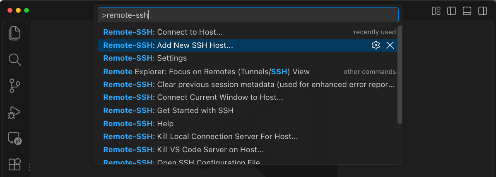
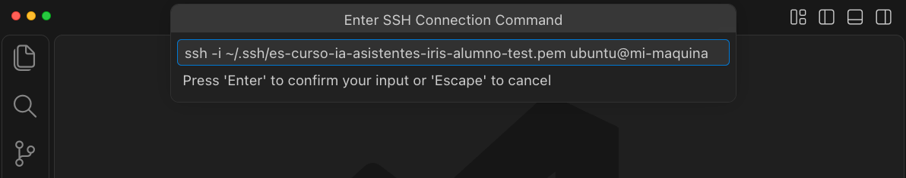
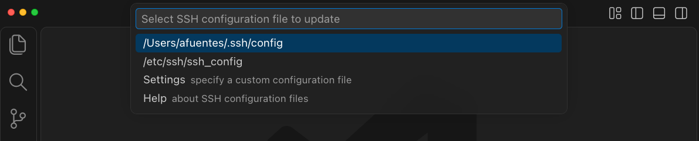
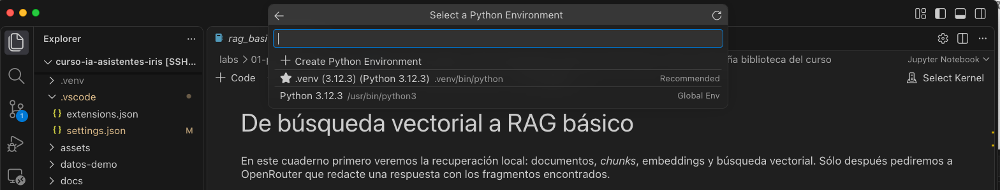
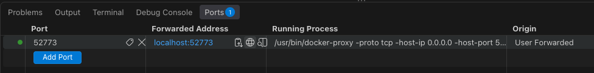

# Tu entorno del curso en AWS

Conecta VS Code a tu máquina del curso, configura OpenRouter y abre IRIS. El instructor ya ha preparado Ubuntu, Docker, IRIS, el repositorio, `.env` y el entorno Python `.venv`. Los contenedores están detenidos.

**En tu portátil sólo necesitas** [VS Code](https://code.visualstudio.com/), la extensión [Remote - SSH de Microsoft](https://marketplace.visualstudio.com/items?itemName=ms-vscode-remote.remote-ssh) y un cliente SSH. No necesitas una cuenta AWS ni instalar Docker o Python.

> **💻 Dónde vas a trabajar** VS Code se abre en tu portátil, pero los archivos, la terminal y Python se ejecutan en tu máquina de AWS. Una vez conectado, usa la terminal de esa ventana.

## 📋 Antes de empezar

Abre el correo de acceso que te enviará el instructor. Incluye:

| Dato | Lo usarás para… |
| --- | --- |
| Servidor y usuario SSH (`ubuntu`) | Conectar con tu máquina |
| Nombre de la máquina y carpeta del curso | Identificar tu entorno y abrir el proyecto |
| Archivo `.pem` adjunto | Autenticar la conexión |
| API key individual de OpenRouter | Generar respuestas en los labs |

Descarga el `.pem` adjunto y guárdalo en tu portátil, fuera del repositorio. Anota su ruta completa y consérvalo para las próximas sesiones. No lo copies a AWS ni compartas su contenido.

El instructor te facilitará también las credenciales de IRIS.

### En Windows: prepara los permisos de la clave

Antes de conectar, abre **PowerShell en tu portátil** y ejecuta estos comandos en orden. Sustituye `tu-clave.pem` en las tres líneas por la ruta real del archivo descargado. Conserva las comillas, especialmente si la ruta contiene espacios.

```powershell
# 1. Restablecer los permisos por defecto
icacls.exe "tu-clave.pem" /reset

# 2. Dar permiso de lectura (R) a tu usuario actual
icacls.exe "tu-clave.pem" /grant:r "$($env:USERNAME):(R)"

# 3. Deshabilitar la herencia y quitar los permisos heredados
icacls.exe "tu-clave.pem" /inheritance:r
```

Ejecuta estos comandos en PowerShell, no en el símbolo del sistema (`cmd`) ni en la terminal remota de AWS. Si las políticas corporativas impiden cambiar los permisos, pide ayuda al soporte.

---

## 1. Añade tu conexión en VS Code

Abre la **paleta de comandos** con `Cmd+Shift+P` en macOS o `Ctrl+Shift+P` en Windows y Linux. Ejecuta **Remote-SSH: Add New SSH Host...**.

*Puedes pulsar sobre las capturas para verlas a tamaño completo.*

<a href="../assets/vscode-remote-ssh-add-host.png"></a>

Pega el comando que corresponda. Sustituye la ruta del `.pem` y `IP_DE_TU_MAQUINA` por el valor de **Servidor** del correo. Si recibiste otro usuario, sustituye `ubuntu`.

**macOS o Linux**

```bash
ssh -i "/RUTA/COMPLETA/A/TU/CLAVE.pem" ubuntu@IP_DE_TU_MAQUINA
```

**Windows**

```text
ssh -i "C:/Users/TU_USUARIO/Downloads/CLAVE.pem" ubuntu@IP_DE_TU_MAQUINA
```

<a href="../assets/vscode-remote-ssh-connection-command.png"></a>

*La captura usa una ruta y un servidor de ejemplo. Introduce los tuyos y pulsa Enter.*

Cuando aparezca **Select SSH configuration file to update**, elige el archivo de tu usuario, normalmente la primera opción:

| Sistema | Archivo |
| --- | --- |
| macOS | `/Users/TU_USUARIO/.ssh/config` |
| Linux | `/home/TU_USUARIO/.ssh/config` |
| Windows | `C:\Users\TU_USUARIO\.ssh\config` |

VS Code guarda la conexión. No necesitas editar ese archivo ni seleccionar el del sistema (`/etc/ssh/ssh_config`).

<a href="../assets/vscode-remote-ssh-config-file.png"></a>

*Ejemplo en macOS. La ruta incluirá tu nombre de usuario.*

## 2. Conecta y abre la carpeta del curso

1. Ejecuta **Remote-SSH: Connect to Host...** desde la paleta y elige tu servidor.
2. Si pregunta por el sistema remoto, selecciona **Linux**. En la primera conexión, confirma con el instructor la huella del servidor antes de aceptarla.
3. Espera a que termine la preparación de VS Code Server. Comprueba que la esquina inferior izquierda muestra **SSH:** seguido de tu servidor.
4. Usa **File → Open Folder...** y abre esta carpeta:

   ```text
   /home/ubuntu/curso-ia-asistentes-iris
   ```

5. Abre **Terminal → New Terminal** y actualiza el curso:

   ```bash
   cd /home/ubuntu/curso-ia-asistentes-iris
   git pull --ff-only
   ```

> **💡 A partir de aquí, usa la terminal remota de VS Code.** Si falta la carpeta o falla la actualización, avisa al instructor. No descartes archivos ni reinstales el entorno. Si la actualización requiere cambios de dependencias o de IRIS, el instructor indicará cómo aplicarlos.

## 3. Selecciona el Python del curso

El entorno `.venv` ya está creado y tiene las dependencias instaladas. Sólo tienes que seleccionarlo y activarlo.

1. Instala las extensiones recomendadas cuando VS Code las sugiera. Si no aparece el aviso, abre la **paleta de comandos** y ejecuta **Extensions: Show Recommended Extensions**. También puedes abrir **Extensions** y buscar `@recommended`. Desde esa lista, instala **Python**, **Jupyter** e **InterSystems ObjectScript** en la máquina remota con **Install in SSH: …**. Remote - SSH se instala en el portátil.
2. Ejecuta **Python: Select Interpreter** desde la paleta y selecciona esta ruta. Si no aparece, usa la opción para introducirla manualmente:

   ```text
   /home/ubuntu/curso-ia-asistentes-iris/.venv/bin/python
   ```

3. Al abrir un notebook, pulsa **Select Kernel**, arriba a la derecha, y elige ese mismo entorno `.venv`.

<a href="../assets/vscode-remote-jupyter-kernel.png"></a>

*Elige `.venv`, que aparece como recomendado, con la ruta `.venv/bin/python`.*

Para usar Python desde la terminal, activa también el entorno:

```bash
source .venv/bin/activate
python --version
```

Si falta `.venv`, avisa al instructor.

## 4. Añade tu clave y arranca IRIS

**Edita el archivo preparado**

El archivo `.env` ya existe en la carpeta del curso. Ábrelo desde el explorador de VS Code remoto y pega la API key de tu correo en `OPENROUTER_API_KEY`. Conserva el modelo del curso y las demás variables:

```dotenv
OPENROUTER_API_KEY=PEGA_AQUI_TU_CLAVE
OPENROUTER_MODEL=openai/gpt-oss-20b
```

**Arranca IRIS**

Guarda el archivo **antes de arrancar IRIS**. Los contenedores se han dejado detenidos con `docker compose stop`. Para levantar IRIS con tu configuración:

```bash
docker compose up -d iris-aihub
docker compose ps
```

Comprueba que `iris-aihub` aparece en ejecución. El arranque de IRIS puede tardar un poco. Si Docker da un error de permisos, avisa al instructor.

> **💡 Usa `up -d` para arrancar con la configuración de `.env`.** Docker Compose recrea el contenedor si detecta cambios en sus variables y conserva los datos de `irisdata`. No necesitas reconstruir la imagen. No borres `irisdata` ni publiques `.env` en Git.

Si tenías notebooks o aplicaciones Python abiertos, reinicia sus kernels o procesos. La clave se usará al generar respuestas en Python y en los agentes de AI Hub. Los embeddings son locales y no necesitan esa clave.

## 5. Abre el Portal de IRIS

1. En la ventana remota, abre la pestaña **Ports**. Si no aparece, ejecuta **Ports: Focus on Ports View** desde la paleta.
2. Pulsa **Forward a Port** e introduce `52773`.
3. Pulsa **Open in Browser** en esa fila. En la dirección que se abra, usa la ruta `/csp/sys/UtilHome.csp`.
4. Entra con las credenciales de IRIS facilitadas por el instructor.

<a href="../assets/vscode-remote-forward-port.png"></a>

*En la fila de `52773`, pulsa el icono del globo para abrir el navegador.*

Si el puerto local es `52773`, puedes abrir directamente:

[**Abrir el Portal de IRIS**](http://localhost:52773/csp/sys/UtilHome.csp)

Si VS Code asigna otro puerto local, usa el que muestre **Forwarded Address**. El navegador de tu portátil llega a IRIS mediante la conexión SSH. No necesitas abrir más puertos en AWS.

<details>
<summary>Conexiones de IRIS y puertos de los labs opcionales</summary>

Python se conecta desde AWS a IRIS, normalmente con `IRIS_HOST=localhost` y `IRIS_PORT=1972`. La extensión ObjectScript remota utiliza normalmente `localhost:52773`, namespace `USER` y las credenciales facilitadas. La IP pública se utiliza para SSH.

| Aplicación | Puerto remoto que debes reenviar |
| --- | --- |
| Portal de IRIS | `52773` |
| FastAPI opcional | `8000` |
| Gradio opcional | `7860` |

FastAPI y Gradio deben estar arrancados en sus labs para poder abrirlos. Los notebooks usan el kernel remoto y no necesitan un puerto Jupyter público.

</details>

## 6. ✅ Comprueba que puedes empezar

- [ ] VS Code muestra **SSH:** y tu servidor en la esquina inferior izquierda.
- [ ] Tienes abierta la carpeta `/home/ubuntu/curso-ia-asistentes-iris`.
- [ ] La terminal y los notebooks usan `.venv`.
- [ ] `docker compose ps` muestra `iris-aihub` en ejecución.
- [ ] Has guardado tu clave en el `.env` remoto y aplicado la configuración.
- [ ] Puedes abrir el Portal de IRIS.

Continúa con la [**Comprobación del Lab 00**](../labs/00-setup/README.md#comprobación). Esta prueba no llama al modelo ni consume créditos de OpenRouter. Si el instructor ya cargó los datos demo, no vuelvas a cargarlos.

---

## ↩️ Cuando vuelvas otro día

Conecta con **Remote-SSH: Connect to Host...**, abre la misma carpeta y activa `.venv` en cada terminal nueva. Reenvía los puertos si hace falta. Reutiliza `.env` y los datos. Si IRIS está detenido, ejecuta `docker compose up -d iris-aihub`. Si cambias tu API key, guarda `.env` y ejecuta ese mismo comando para aplicar el cambio. `start` o `restart` no incorporan variables nuevas.

Cerrar VS Code no apaga tu máquina. El instructor gestiona su encendido y apagado. Si cambia la IP, añade una conexión con la IP nueva y el mismo `.pem`.

## 🛠️ Si algo falla

Busca tu síntoma en esta tabla. Al pedir ayuda, comparte el error sin incluir la clave OpenRouter ni el contenido del `.pem`.

| Mensaje o síntoma | Qué hacer |
| --- | --- |
| `Connection timed out` | Comprueba la IP y tu red. Pide al instructor que revise si la máquina está encendida y permite tu acceso por SSH (TCP 22) |
| `Permission denied (publickey)` | Revisa el usuario, la ruta del `.pem` y que sea el archivo asignado |
| `UNPROTECTED PRIVATE KEY FILE` | Sigue las instrucciones de permisos que aparecen debajo |
| Huella SSH distinta de la anterior | Confirma con el instructor si se ha sustituido la máquina antes de modificar `known_hosts` |
| Python no encuentra un paquete | Selecciona `.venv` como intérprete y como kernel del notebook |
| Docker no está disponible o da un error de permisos | Avisa al instructor |
| El Portal no responde | Comprueba que IRIS está en ejecución y que has reenviado `52773`. Usa el puerto local mostrado por VS Code |
| OpenRouter rechaza la generación | Revisa la clave, el saldo y el modelo permitido. Si cambiaste `.env`, vuelve a aplicar la configuración del paso 4 |

<details>
<summary>Permisos de la clave .pem</summary>

**En macOS o Linux**, abre una terminal de tu **portátil** y ejecuta con la ruta real del archivo:

```bash
chmod 400 "/RUTA/COMPLETA/A/TU/CLAVE.pem"
```

**En Windows**, sigue los [comandos de PowerShell para preparar los permisos de la clave](#en-windows-prepara-los-permisos-de-la-clave).

Vuelve a conectar desde VS Code.

</details>

<details>
<summary>No se encuentra el comando ssh</summary>

Ejecuta `ssh -V` en una terminal de tu **portátil**. En Windows, si falta, instala **OpenSSH Client** desde las características opcionales del sistema o pide ayuda al soporte.

</details>

<details>
<summary>Comprobar que Python encuentra la clave de OpenRouter</summary>

Desde la carpeta del curso, en la terminal remota y con `.venv` activo:

```bash
python -c 'from dotenv import load_dotenv; import os; load_dotenv(".env"); print("Clave configurada:", bool(os.getenv("OPENROUTER_API_KEY")))'
```

`True` confirma que hay un valor sin mostrarlo. No verifica que la clave sea válida o tenga saldo. Las variables exportadas en la terminal tienen prioridad sobre `.env`. La prueba real de generación se hará cuando lo indique el lab o el instructor y consume créditos.

</details>

Más ayuda en la [documentación de VS Code Remote SSH](https://code.visualstudio.com/docs/remote/ssh).
