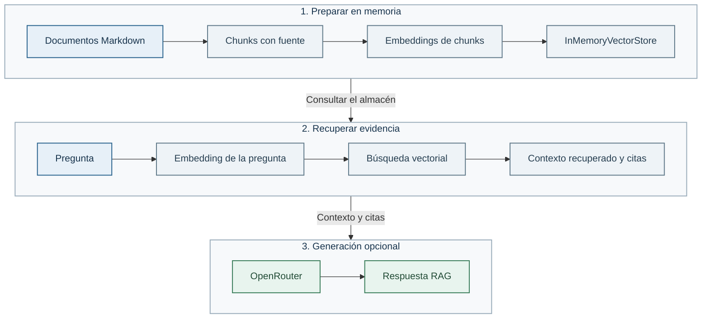

# Lab 01 — De búsqueda vectorial a RAG básico

## Objetivo

Construir un RAG pequeño, pero completo y fácil de inspeccionar. Primero trabajarás sólo con documentos, embeddings y búsqueda vectorial. Después añadirás un modelo de OpenRouter que redacta una respuesta a partir de los fragmentos recuperados. Así se ve con claridad qué aporta cada pieza.

## Conceptos

Un *embedding* es una lista de números que representa parte del significado de un texto. Gracias a ella podemos comparar una pregunta con los fragmentos de los documentos, aunque no compartan exactamente las mismas palabras.

El *chunking* divide un documento largo en pasajes más pequeños. Recuperamos los pasajes más parecidos a la pregunta y los usamos como contexto para el modelo generativo. Esa última unión —recuperar contexto y generar con él— es lo que convierte la búsqueda vectorial en RAG (*Retrieval-Augmented Generation*).

## La pequeña biblioteca del curso

El lab usa `learning_ai_rag`, una biblioteca Python pequeña que viene incluida en `packages/learning_ai_rag/`. No es LangChain ni otro framework: es código del curso, escrito para que puedas seguir el recorrido sin capas ocultas.

- `load_markdown_documents` lee los Markdown y conserva su título y fuente.
- `chunk_documents` conserva las secciones Markdown y crea ventanas de hasta 120 palabras dentro de cada sección, con 30 de solapamiento. Conserva también la sección completa para poder ampliar el contexto recuperado.
- `SentenceTransformerEmbedder` usa el modelo local para crear embeddings.
- `InMemoryVectorStore` guarda temporalmente los chunks y vectores, y busca los más parecidos a una pregunta.
- `RAGPipeline` aplica el umbral de similitud, amplía a secciones completas y, sólo si se lo pides, se lo entrega al generador de OpenRouter.

Una curiosidad: la búsqueda vectorial está hecha directamente con NumPy. `InMemoryVectorStore` guarda los embeddings en una matriz y los normaliza. Para cada pregunta, calcula `scores = self.embeddings @ query_vector`: el producto escalar de vectores normalizados equivale a su similitud coseno. Después ordena las puntuaciones y devuelve los fragmentos más parecidos. Es una búsqueda exacta que compara con todos los vectores, sin un índice como HNSW. Para el corpus pequeño del lab, permite ver el mecanismo en unas pocas líneas de [store.py](../../packages/learning_ai_rag/learning_ai_rag/store.py).

La búsqueda recoge hasta nueve fragmentos candidatos, reordena coincidencias cercanas usando también los títulos de documento y sección y entrega hasta tres secciones distintas. Cada coincidencia de título añade 0,05 a la puntuación usada para ordenar. El valor de similitud mostrado sigue siendo el coseno original. No se envía todo el documento ni todo el corpus. El identificador de cita es el del fragmento que originó la selección y el texto expuesto es su sección completa.

No hace falta memorizar las clases. La idea importante es distinguir qué hace cada una: leer, partir, representar, buscar y —al final— redactar usando la evidencia. En el notebook las iremos usando una por una.



## Mira las fuentes

Abre `datos-demo/knowledge/` y hojea los Markdown. Son las políticas que el ejercicio podrá consultar: cancelaciones, entregas, devoluciones y garantías. No hay ningún conocimiento secreto detrás del telón: si una regla no aparece en esos documentos, el RAG no debería inventársela.

## Antes de empezar

Necesitas el [entorno Python del Lab 00](../00-setup/README.md#entorno-python-para-los-labs-0103). Si vienes siguiendo el curso, ya está preparado. En una terminal nueva, activa el entorno desde la raíz del repositorio:

```bash
source .venv/bin/activate
```

Para el notebook, selecciona `.venv` como kernel. En este lab crearás los chunks y embeddings en memoria. No necesitas IRIS ni los datos de pedidos.

La primera ejecución puede descargar el modelo de embeddings. La búsqueda local no necesita ninguna clave cloud.

## Recorrido principal: notebook

Abre [rag_basico.ipynb](rag_basico.ipynb) con la extensión Jupyter de VS Code y selecciona `.venv` como kernel. Ejecútalo de arriba abajo, con calma: cada celda enseña una pieza del recorrido antes de unirlas. Es la mejor forma de entender qué hace el RAG, no sólo de comprobar que funciona.

El cuaderno carga los Markdown, los divide en chunks de 120 palabras con 30 de solapamiento y usa el modelo local `sentence-transformers/paraphrase-multilingual-MiniLM-L12-v2`. Es un modelo multilingüe que convierte tanto los chunks como la pregunta en embeddings de 384 dimensiones.

Los embeddings y los chunks se guardan en `InMemoryVectorStore`, un almacén temporal en memoria. Vive sólo durante esta ejecución, se reinicia al volver a ejecutar el programa y no escribe nada en la base de datos. Para este lab viene genial porque deja al descubierto la búsqueda vectorial sin más infraestructura.

Prueba una pregunta sobre la garantía de un reacondicionado y revisa el texto recuperado, el fichero de origen, el identificador del chunk y la similitud. La puntuación ayuda a comparar resultados. No es una probabilidad ni un sello de verdad.

La siguiente celda añade OpenRouter sólo si has definido `OPENROUTER_API_KEY`. Compara la evidencia anterior con la respuesta redactada: ése es el salto de búsqueda vectorial a RAG.

## Repetir el flujo desde terminal

Cuando hayas visto las piezas en el notebook, usa el script como versión compacta y reproducible del mismo recorrido:

```bash
python labs/01-python-rag-basico/rag_basico.py
```

También puedes pasar otra pregunta:

```bash
python labs/01-python-rag-basico/rag_basico.py --question "¿Qué garantía tiene un reacondicionado?"
```

## Añadir la generación RAG

Si todavía no has configurado OpenRouter, sigue [la guía compartida](../../docs/guia-acceso-aws-alumno.md#4-añade-tu-clave-y-arranca-iris). Reutiliza la clave y el modelo de `.env`. El modelo por defecto es `openai/gpt-oss-20b`.

```bash
python labs/01-python-rag-basico/rag_basico.py --generate
```

En el notebook, vuelve a ejecutar la celda de generación después de configurar la clave. En terminal, usa `--generate`: el mismo contexto recuperado se envía al modelo mediante la API de chat de OpenRouter. El prompt le pide responder sólo con esa evidencia y citar los identificadores de los chunks. Después el programa muestra también las citas que controlamos nosotros, no sólo las que escriba el modelo.

Aquí está la diferencia importante:

- Sin `--generate`, ves qué documentos ha encontrado la búsqueda vectorial.
- Con `--generate`, el modelo redacta una respuesta usando esos documentos como contexto. Eso ya es un RAG básico.

## Fallo y control

Prueba esta pregunta, que pide un dato ausente de las políticas:

```bash
python labs/01-python-rag-basico/rag_basico.py --question "¿Cuál es el número de tarjeta de crédito del cliente?" --generate
```

Con el modelo, el corpus y el umbral de 0,35 de este lab, ningún fragmento supera el umbral y el pipeline se abstiene antes de llamar a OpenRouter, incluso con `--generate`. Verás `Resultado: abstención por falta de evidencia.`

La formulación importa: quitar «de crédito» puede hacer que se recuperen políticas aunque no contengan ese dato. Compara ambas preguntas e inspecciona la evidencia. La similitud por sí sola no comprueba que exista una respuesta.

## Ideas para explorar por tu cuenta

Si quieres profundizar, puedes probar alguna de estas ideas. Son opcionales y no forman parte de una entrega obligatoria.

- Probar tamaños de chunk de 80 y 180 palabras y observar qué ocurre con las citas.
- Buscar una regla que conozcas de un Markdown y comprobar qué chunk la recupera.
- Comparar la misma pregunta con y sin `--generate`. ¿Qué información añade el modelo y qué evidencia conserva? La variante con generación consume créditos.

## Siguiente paso

En el Lab 02 moverás esta idea a un almacén vectorial persistente y consultarás los vectores con SQL en IRIS.

El umbral de similitud no demuestra que el contexto contenga una respuesta. Por ejemplo, la pregunta sobre el número de tarjeta del cliente todavía puede recuperar textos de políticas. La evaluación del Lab 03 utiliza la formulación «tarjeta de crédito». La variante más ambigua sigue ilustrando una limitación de este umbral.
