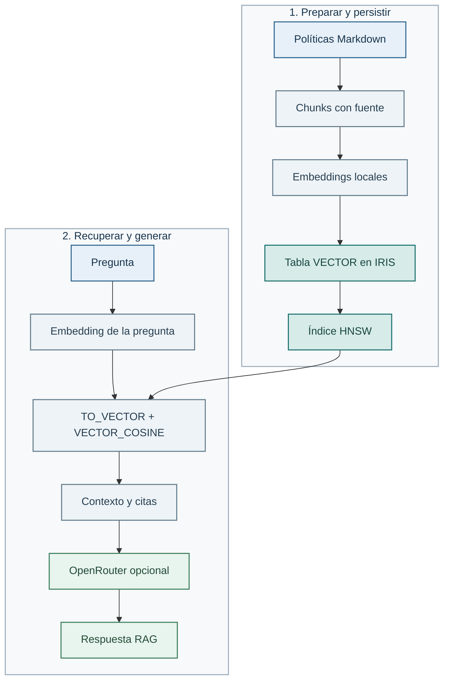

# Lab 02 — Búsqueda vectorial SQL en IRIS

## Objetivo

En el Lab 01 usamos `InMemoryVectorStore`: los chunks y sus embeddings vivían
sólo mientras el programa estaba en marcha. Ahora haremos el mismo recorrido
con un almacén persistente en IRIS. Crearemos una tabla vectorial, guardaremos
los embeddings de las políticas, recuperaremos contexto desde IRIS y lo
usaremos para completar un RAG real.

La idea no es aprender SQL de memoria. Es entender qué cambia cuando los
vectores dejan la memoria de Python y pasan a una base de datos que puede
indexarlos y buscarlos.

## Qué vamos a usar

Seguimos usando la pequeña biblioteca Python del curso,
`learning_ai_rag`. No hay un framework que esconda el proceso.

- `load_markdown_documents` y `chunk_documents` preparan las mismas políticas
  que ya conoces.
- `SentenceTransformerEmbedder` crea embeddings locales de 384 dimensiones.
- `IrisVectorStore` es un adaptador pequeño del curso que ejecuta SQL en IRIS:
  crea la tabla, carga los chunks y lanza la búsqueda.
- `RAGPipeline` busca fragmentos y los amplía a sus secciones Markdown,
  conserva las citas y puede entregarlas
  al generador OpenRouter del Lab 01.
- IRIS guarda cada embedding en una columna `VECTOR(DOUBLE, 384)` y crea un
  índice HNSW con distancia coseno.



## Antes de empezar

Necesitas IRIS arrancado y el [entorno Python y `.env` del Lab 00](../00-setup/README.md).
Si entras directamente en este lab, prepara allí esos componentes primero.
Los datos estructurados de pedidos no son necesarios para esta búsqueda.
En una terminal nueva, activa el entorno:

```bash
source .venv/bin/activate
```

El notebook y el script leen las variables `IRIS_*` de `.env`. Para el notebook,
selecciona `.venv` como kernel. En este lab crearás la tabla vectorial, su índice
HNSW y el corpus. Elige notebook o script para esa preparación inicial.

## Recorrido principal: notebook

Abre [vector_search.ipynb](vector_search.ipynb) con la extensión Jupyter de VS
Code y selecciona `.venv` como kernel. Ejecútalo de arriba abajo: primero
revisarás los documentos, los chunks y el tamaño de los embeddings. Después te
conectarás a IRIS, crearás la estructura, harás la consulta vectorial y
terminarás el RAG con la evidencia recuperada.

Hay dos celdas que escriben en IRIS:

1. **Inicializar** crea `Learning_RAG.ChunkEmbedding` y su índice HNSW. Se
   ejecuta una sola vez en una instancia nueva.
2. **Cargar** reemplaza el corpus de práctica con los chunks de las políticas. Puedes repetirla
   cuando quieras regenerar el corpus del curso.

Si el instructor ya preparó la tabla o la creaste con el script, omite la celda
**Inicializar**. Si el corpus ya está cargado y no has cambiado los documentos,
puedes omitir también **Cargar** y continuar con la consulta.

El notebook no muestra el vector crudo: no ayuda a entender la búsqueda y el
driver lo devuelve como texto. En su lugar, muestra la consulta, la similitud,
las fuentes y los fragmentos que sí sirven para razonar sobre el resultado.

La consulta importante tiene esta forma:

```sql
SELECT TOP 3 ChunkId, SourceName, ChunkText,
       VECTOR_COSINE(Embedding, TO_VECTOR(?, DOUBLE, 384)) AS score
FROM Learning_RAG.ChunkEmbedding
ORDER BY score DESC
```

`TO_VECTOR` da al parámetro el mismo tipo y dimensión que la columna. `TOP` y
`ORDER BY score DESC` no están de adorno: permiten que IRIS use el índice HNSW.

Al final, el notebook pasa los mismos chunks recuperados a `RAGPipeline`. Si
configuras `OPENROUTER_API_KEY`, una última celda genera una respuesta con OpenRouter.
Sin clave puedes completar todo el recorrido de IRIS y revisar la evidencia.

## Repetir el flujo desde terminal

El script es una alternativa compacta al notebook. Si empiezas con una base
sin la tabla de este lab, prepara la tabla, el índice y el corpus una sola vez:

```bash
python labs/02-sql-vector-search/vector_search.py --initialize --load
```

Si ya completaste el notebook o el instructor preparó la tabla y el corpus,
ejecuta directamente la consulta:

```bash
python labs/02-sql-vector-search/vector_search.py --question "¿Cuándo puedo devolver un producto?"
```

Para completar la generación RAG con la evidencia de IRIS, añade `--generate`:

```bash
python labs/02-sql-vector-search/vector_search.py --question "¿Cuándo puedo devolver un producto?" --generate
```

Si cambias los documentos o quieres volver a calcular sus embeddings, ejecuta
solamente la carga:

```bash
python labs/02-sql-vector-search/vector_search.py --load
```

## Salida esperada

Una pregunta sobre devolución debería situar `returns-policy.md` entre los
primeros resultados. Verás la fuente, el identificador del chunk, la similitud
y la evidencia que recibirá el modelo. Con `--generate`, verás también la
respuesta RAG y sus citas.

## Fallo y control

Si la tabla o el índice ya existen, no vuelvas a ejecutar la inicialización. Si
aparece un error de dimensiones, comprueba que usas el modelo multilingüe
predeterminado de 384 dimensiones: el tipo de `TO_VECTOR` y el de la columna
deben coincidir exactamente.

## Ideas para explorar por tu cuenta

Si quieres profundizar, puedes probar alguna de estas ideas. Son opcionales y
no forman parte de una entrega obligatoria.

- Comparar una pregunta del Lab 01 en memoria y en IRIS. ¿Cambian las fuentes
  recuperadas?
- Variar la pregunta y observar qué fragmentos pasan a ser relevantes.
- Explorar por qué `TOP ... ORDER BY score DESC` forma parte del diseño de la
  consulta, además de determinar cómo se presenta el resultado.

## Siguiente paso

Pasa al Lab 03 para medir el mismo RAG persistente de IRIS con casos
versionados.

Si cambias la fragmentación o actualizas los documentos, recarga con `--load`.
Esa opción reemplaza el corpus de práctica y elimina fragmentos antiguos. No
necesitas volver a crear la tabla. El pipeline contrasta cada resultado con
los Markdown versionados antes de ampliarlo a una sección. Si no coinciden,
pide recargar el índice en lugar de mezclar contextos de versiones distintas.
