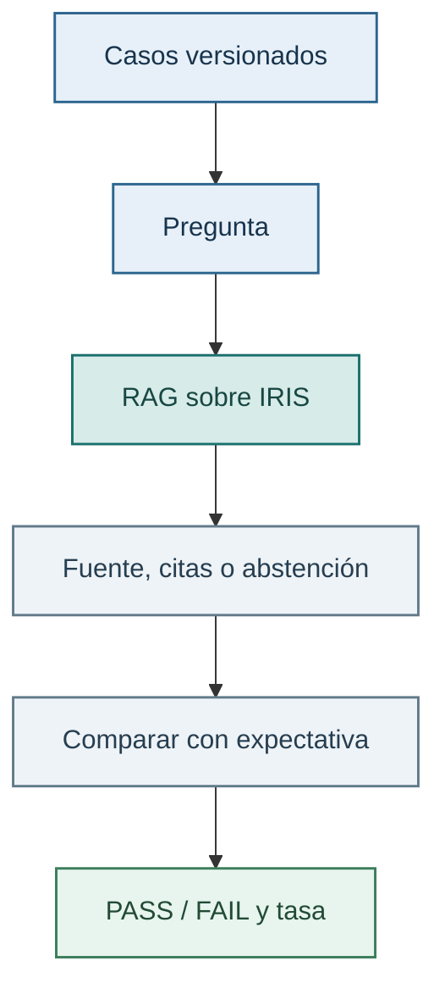

# Lab 03 — Evaluar el RAG en IRIS

## Objetivo

Comprobar de forma repetible que el RAG persistente del Lab 02 recupera la política correcta y se abstiene cuando no hay evidencia. Ya no probaremos una pregunta “a ojo”: usaremos una colección de casos con una expectativa clara y veremos qué ocurre al ejecutar todos seguidos.

Aquí *evaluable* significa precisamente eso: podemos repetir la comprobación y obtener `PASS` o `FAIL` según una regla conocida. No evalúa si la prosa de un modelo suena bonita. Evalúa las piezas comprobables del RAG: recuperación, citas y prudencia.

## ¿Qué es una evaluación RAG?

Piensa en ella como una suite de tests para la parte de recuperación. Antes de pedir a un LLM que redacte una respuesta, el RAG debe traer el contexto correcto. Para cada pregunta definimos la fuente esperada y comprobamos si el sistema la recupera:

```json
{
  "question": "¿Qué garantía tiene un producto reacondicionado?",
  "expected_source": "warranty-policy.md",
  "required_terms": ["12 meses"]
}
```

La evaluación convierte la pregunta en embedding, busca los chunks en IRIS y comprueba que el contexto incluya la fuente esperada y sus reglas requeridas. Si ambas están presentes, es `PASS`. Si no, es `FAIL`. También incluimos casos de abstención: preguntas para las que no existe evidencia y que el sistema debe rechazar con prudencia.

Esto sirve para detectar regresiones cuando cambias el chunking, los documentos, el modelo de embeddings, el umbral o el vector store. Una respuesta generada puede sonar muy convincente y, aun así, basarse en una fuente equivocada. Por eso comprobamos primero la recuperación. La calidad de la prosa del LLM es otro nivel de evaluación, más variable, que sólo probamos en la batería opcional de generación descrita más abajo.

## Qué vamos a usar

- La tabla vectorial y el índice HNSW que creaste en el Lab 02.
- Los casos versionados de `datos-demo/evaluation/rag-cases.json`.
- `RAGPipeline`, que recupera desde IRIS, conserva las citas y se abstiene si no encuentra evidencia suficiente.
- Las funciones de evaluación de `learning_ai_rag`, que comparan el resultado con la fuente, las reglas o la abstención esperadas.

El recorrido principal de este lab no llama a OpenRouter. Así los resultados son deterministas, no consumen créditos y sirven para detectar si un cambio en el chunking, el modelo de embeddings o el umbral ha empeorado la recuperación.



## Antes de empezar

Completa primero el Lab 02: la tabla, el índice HNSW y el corpus deben existir en IRIS. Este laboratorio sólo los consulta. No crea ni carga nada.

Reutiliza el entorno Python y la conexión de `.env` preparados en el [Lab 00](../00-setup/README.md). En una terminal nueva, activa el entorno:

```bash
source .venv/bin/activate
```

Para el notebook, selecciona `.venv` como kernel. Aquí ejecutarás los casos de evaluación. No hay dependencias ni estructuras nuevas que instalar.

Si la comprobación previa indica que falta la tabla, el índice o el corpus, vuelve a [la preparación del Lab 02](../02-sql-vector-search/README.md#repetir-el-flujo-desde-terminal). Sigue la opción que corresponda: inicializar sólo si la tabla no existe, o cargar con `--load` si ya existe y falta el corpus. Si falta sólo el índice, revisa su creación en el Lab 02 antes de repetir la inicialización de una tabla existente.

## Recorrido principal: notebook

Abre [evaluar_rag.ipynb](evaluar_rag.ipynb) en VS Code y selecciona `.venv` como kernel. El cuaderno muestra primero los casos, después comprueba que el corpus de IRIS está listo y finalmente enseña cada expectativa junto a su resultado. Así podrás investigar un `FAIL` concreto antes de mirar la tasa total.

## Repetir la evaluación desde terminal

Cuando hayas recorrido el notebook, ejecuta la versión compacta:

```bash
python labs/03-python-rag-evaluable/evaluar_rag.py
```

El programa confirma primero el número de chunks disponible en IRIS y después imprime un `PASS` o `FAIL` por caso, seguido de la tasa global.

## Salida esperada

Los casos sobre una política concreta deben aportar la fuente y las reglas esperadas dentro del contexto. El caso sensible debería abstenerse y no mostrar citas. Una fuente equivocada cuenta como fallo aunque la respuesta parezca razonable: el objetivo es que la evidencia sea correcta.

La evaluación comprueba que la fuente esperada esté en el **contexto entregado** y que sus textos contengan las reglas de `required_terms`. No basta con recuperar el nombre correcto de un archivo. Sigue mostrando el primer resultado y todas las fuentes del contexto: la regla puede proceder de una segunda sección.

La batería completa tiene once casos. Con la formulación «tarjeta de crédito», la comprobación en memoria del modelo y corpus actuales obtiene **10/11**: el caso de cuenta bancaria del cliente todavía no se abstiene. Al ejecutar el recorrido en IRIS, revisa su resultado y los textos recuperados. Ese caso permanece como fallo conocido para mostrar que superar el umbral de similitud no demuestra que exista una respuesta. Un FAIL no implica por sí solo un problema de instalación.

## Fallo y control

Este lab no arregla ni reescribe datos automáticamente. Si la comprobación previa falla, te dice qué comando del Lab 02 debes ejecutar. Si la evaluación falla, revisa primero el caso concreto, los chunks recuperados y su fuente antes de cambiar el modelo o el umbral a ciegas.

## Opcional: comprobar respuestas generadas

Esta batería se ejecuta aparte para validar cambios. No añade pasos al RAG, no modifica los notebooks ni la UI y no necesita IRIS. Utiliza el mismo pipeline Python, con el corpus en memoria y el generador de OpenRouter del curso.

Desde la raíz, con `.venv` activo y `OPENROUTER_API_KEY` configurada en `.env`:

```bash
python scripts/test_rag_generation.py --run
```

Sin `--run` sólo muestra cómo ejecutarla: no carga modelos ni llama a la API. `pytest` tampoco realiza estas llamadas. El modelo se selecciona con `OPENROUTER_MODEL`, igual que en los labs. Por defecto es GPT-OSS 20B.

Los seis casos están en `datos-demo/evaluation/generation-cases.json`:

- Garantía de reacondicionados: 12 meses.
- Desgaste normal: exclusión de garantía.
- Devolución: 30 días desde la entrega.
- Pedido sin fecha real de entrega: explicar el plazo sin inventar una fecha límite.
- Tarjeta y cuenta bancaria del cliente: reconocer que no dispone del dato.

Se comprueban patrones de texto e identificadores de cita presentes en el contexto. No se utiliza otro LLM como evaluador. Un error de conexión o una respuesta vacía se registra como `ERROR`, no como un acierto. El programa termina con código 1 si algún caso falla o produce un error.

La ejecución consume hasta seis llamadas. Una abstención previa del pipeline no llama al generador. No hay reintentos automáticos. Para repetir cada caso tres veces y conservar un registro separado:

```bash
python scripts/test_rag_generation.py --run --repeats 3 --output tmp/generation-gptoss.json
```

Por defecto guarda respuestas, contexto, fuentes y fallos en `tmp/generation-evaluation.json`, ignorado por Git. Revisa ese registro además del PASS/FAIL: los patrones pueden producir falsos positivos o negativos y una cita válida no demuestra que respalde la conclusión. Estos checks no certifican todas las afirmaciones de la respuesta.

La negativa del modelo y la abstención del buscador se registran por separado. El modelo puede reconocer que no sabe el número de tarjeta aunque el buscador haya entregado políticas irrelevantes. Que pase ese caso de generación no resuelve por sí solo los fallos de recuperación. Esta batería tampoco valida las herramientas ni las skills nativas de AI Hub.

## Ideas para explorar por tu cuenta

Si quieres profundizar, puedes probar alguna de estas ideas. Son opcionales y no forman parte de una entrega obligatoria.

- Añadir un caso sobre una política inexistente y observar si el sistema se abstiene.
- Cambiar el tamaño de chunk en el Lab 02, recargar el corpus y comparar la tasa.
- Pensar qué prueba adicional ayudaría a evaluar la calidad de una respuesta generada por un LLM.

## Siguiente paso

Ya tienes un RAG completo con un vector store persistente y una evaluación repetible. Los siguientes labs conectarán estas ideas con AI Hub y herramientas de IRIS.
