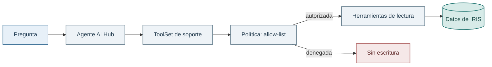

# Lab 04 — IRIS y AI Hub: agente, herramientas y límites

## Objetivo

En este lab montaremos la parte estructurada de un asistente de soporte. Antes de pedir nada a un modelo, veremos qué hace AI Hub por nosotros: mantiene una sesión, descubre un `ToolSet` y permite llamar a herramientas. Las herramientas consultan pedidos, productos y envíos directamente en IRIS.

La idea importante es esta: el modelo no recibe una llave maestra para la base de datos. Sólo puede solicitar las operaciones concretas que publicamos.

## Dónde estamos

**InterSystems IRIS** es la plataforma que ya has usado en los labs anteriores: guarda los datos del dominio, permite consultarlos con SQL y puede almacenar vectores para búsqueda semántica. En este curso, IRIS es tanto la base de datos como el lugar donde vive la lógica ObjectScript del asistente.

**AI Hub** es la capa de IRIS que ayuda a conectar un modelo de lenguaje con esa lógica de forma controlada. Un agente AI Hub mantiene la conversación y puede decidir usar una herramienta. No recibe acceso libre a la base de datos.

Una **herramienta** es una operación pequeña y bien definida, por ejemplo consultar `ORD-002`. Un **ToolSet** agrupa las herramientas que queremos hacer visibles. Y una **política** decide si se autoriza una llamada concreta. Es una separación muy útil: el prompt puede pedir prudencia, pero la política es la que realmente bloquea una escritura.

En este lab verás agente, herramientas y política. En el Lab 05 añadiremos una base de conocimiento para preguntas sobre documentos. En el Lab 06 publicaremos el mismo ToolSet con MCP para que lo pueda usar otro cliente o agente.

## Qué vamos a usar

- **Herramientas de lectura:** abre [OrderTools.cls](../../src/Learning/Tools/OrderTools.cls) y sigue `GetOrder`. Recibe una referencia de pedido, localiza el registro y construye un resultado con datos y su origen. [CatalogTools.cls](../../src/Learning/Tools/CatalogTools.cls) y [ShipmentTools.cls](../../src/Learning/Tools/ShipmentTools.cls) hacen lo mismo para catálogo y envíos.
- **ToolSet:** en [Learning.ToolSet.ReadOnlySupport](../../src/Learning/ToolSet/ReadOnlySupport.cls), fíjate en `XData Definition`. Cada entrada `Tool` enlaza un nombre con una clase y un método. Sus descripciones ayudan al agente a decidir cuándo usar cada herramienta.
- **Autorización:** en [Learning.Policy.ReadOnlySupport](../../src/Learning/Policy/ReadOnlySupport.cls), busca `%CanExecute`. Compara los nombres permitidos con los publicados en el ToolSet. Cualquier herramienta que no esté en la lista queda denegada.
- **Agente:** en [Learning.Agent.Support](../../src/Learning/Agent/Support.cls), céntrate en `Create`. Observa cómo configura `SystemPrompt`, añade el ToolSet con `AddTool` y conecta la política con `SetAuthPolicy`.

Puedes abrir estas clases mientras sigues el diagrama y volver a ellas al ejecutar las pruebas. No hace falta entender cada línea para reconocer qué responsabilidad tiene cada pieza.



## Antes de empezar

Necesitas IRIS y los datos demo preparados y comprobados en el [Lab 00](../00-setup/README.md#comprobación). Si entras directamente aquí, completa esa preparación primero. La tabla vectorial de los Labs 02–03 no es necesaria. En este lab probarás las herramientas, su política y el agente.

Para conversar con el modelo, reutiliza la [configuración de OpenRouter](../../docs/guia-acceso-aws-alumno.md#4-añade-tu-clave-y-arranca-iris). Las pruebas de herramientas y permisos pueden ejecutarse sin clave.

## Explora los datos desde el portal SQL

Antes de probar el agente, abre el [portal SQL de IRIS en USER](http://localhost:52773/csp/sys/exp/%25CSP.UI.Portal.SQL.Home.zen?$NAMESPACE=USER). Comprueba que el namespace seleccionado sea `USER` y ejecuta estas consultas una por una. Son consultas de lectura sobre los datos sintéticos del Lab 00.

El modelo tiene cuatro tablas: `Learning_Data.Customer` (clientes), `Learning_Data.Product` (productos), `Learning_Data.CustomerOrder` (pedidos) y `Learning_Data.Shipment` (envíos). Cada pedido referencia un cliente y un producto. Cada envío referencia un pedido. Es un modelo simplificado para poder seguir el recorrido completo con pocos datos.

Empieza por los clientes y sus identificadores:

```sql
SELECT CustomerId, FullName, CustomerTier
FROM Learning_Data.Customer
ORDER BY CustomerId
```

Después consulta el catálogo. Fíjate en el stock y en los meses de garantía, dos datos que las herramientas podrán recuperar:

```sql
SELECT Sku, ProductName, UnitPrice, StockQuantity, WarrantyMonths
FROM Learning_Data.Product
ORDER BY StockQuantity, Sku
```

Por último, relaciona los pedidos con sus clientes, productos y envíos:

```sql
SELECT TOP 10
    o.OrderRef, c.FullName, p.ProductName,
    o.Quantity, o.OrderStatus, o.OrderDate, o.TotalAmount,
    s.TrackingNumber, s.ShipmentStatus, s.ExpectedDeliveryDate
FROM Learning_Data.CustomerOrder o
JOIN Learning_Data.Customer c ON c.ID = o.Customer
JOIN Learning_Data.Product p ON p.ID = o.Product
LEFT JOIN Learning_Data.Shipment s ON s.CustomerOrder = o.ID
ORDER BY o.OrderRef
```

Las columnas `Customer`, `Product` y `CustomerOrder` guardan referencias al `ID` interno del registro relacionado. No contienen el identificador de negocio, como `CUS-002` u `ORD-002`. El `LEFT JOIN` conserva también los pedidos que todavía no tienen envío.

Localiza `ORD-002`: en los datos iniciales su estado es `Shipped`, con seguimiento `DHL-1002` y estado de envío `InTransit`. Más adelante preguntarás al agente por ese mismo pedido. Así podrás comparar su respuesta con los datos que acabas de consultar. `ExpectedDeliveryDate` es una fecha estimada, no una confirmación de entrega.

## Recorrido principal: terminal ObjectScript

Aquí no usamos notebook. Python no interviene en el flujo y añadir Jupyter sólo haría de intermediario entre tú e IRIS. Abre una terminal de IRIS y ejecuta los comandos por partes: primero las comprobaciones locales, después —si tienes clave— una sesión real de AI Hub.

Abre o reutiliza una [terminal ObjectScript en USER](../00-setup/README.md#abrir-una-terminal-objectscript). Usarás los mismos datos que acabas de consultar en el portal SQL.

## Prueba los permisos de las herramientas

```objectscript
Do ##class(Learning.Test.Support).Run()
```

Salida esperada:

```text
Support checks passed: authorized read and denied write.
```

Ese segundo caso no intenta escribir ni modifica la base: pregunta por `CreateOrder`, que no existe en la allow-list, y comprueba que se bloquea.

## Comprueba los datos que devuelve una herramienta

`Learning.Tools.OrderTools.GetOrder` devuelve además `source`, para que la respuesta posterior pueda explicar de dónde sale el dato. `ReadOnlySupport` no expone un ejecutor SQL genérico: así se entiende con claridad qué puede y qué no puede hacer el asistente.

Las herramientas distinguen `purchaseDate` (compra), `expectedDeliveryDate` (estimación) y `actualDeliveryDate` (null: no consta). Aunque el estado sea Delivered, no hay una fecha real con la que calcular el límite de devolución. Citan registros con `sourceRef`. `sourceUrl=null` significa que no hay un enlace web. Puedes comprobar este contrato sin llamar a un modelo:

```objectscript
Do ##class(Learning.Test.Evidence).Run()
```

Con la clave de OpenRouter, puedes crear una sesión de AI Hub desde la terminal:

```objectscript
Set sc = ##class(Learning.Agent.Support).Create(.agent)
Set session = agent.CreateSession()
Set response = agent.Chat(session, "¿Dónde está ORD-002?")
Do ##class(Learning.Helper).PrintResponse(response.Content)
```

La utilidad [Learning.Helper](../../src/Learning/Helper.cls) imprime cada línea desde el margen izquierdo, normalizando los saltos de línea para la terminal. No modifica `response.Content` ni interpreta Markdown, por lo que las marcas como `**negrita**` siguen visibles. Si ya tenías el curso cargado en IRIS, importa y compila la nueva clase desde la terminal en `USER` y después repite la impresión:

```objectscript
Do $System.Status.DisplayError($System.OBJ.Load("/app/src/Learning/Helper.cls", "ck"))
Do ##class(Learning.Helper).PrintResponse(response.Content)
```

El agente usa OpenRouter con `openai/gpt-oss-20b` por defecto, igual que los Labs Python. Configura `OPENROUTER_API_KEY` y, si quieres otro modelo, `OPENROUTER_MODEL` en `.env`. Consulta [la configuración](../../docs/guia-acceso-aws-alumno.md#4-añade-tu-clave-y-arranca-iris).

La clave es opcional. Sin ella, el núcleo del lab —datos, ToolSet y política— sigue siendo completamente comprobable.

## Ideas para explorar por tu cuenta

Si quieres profundizar, puedes explorar una herramienta de lectura para buscar pedidos por cliente. Es una propuesta opcional y no forma parte de una entrega obligatoria.

Puedes empezar por decidir qué argumentos aceptaría, cómo se publicaría en el ToolSet y si cumple la allow-list. Otra posibilidad es comprobar qué ocurre con un nombre parecido que no esté autorizado.

Siguiente paso: en el Lab 05 incorporaremos políticas Markdown como evidencia semántica, sin perder estos controles sobre los datos estructurados.
