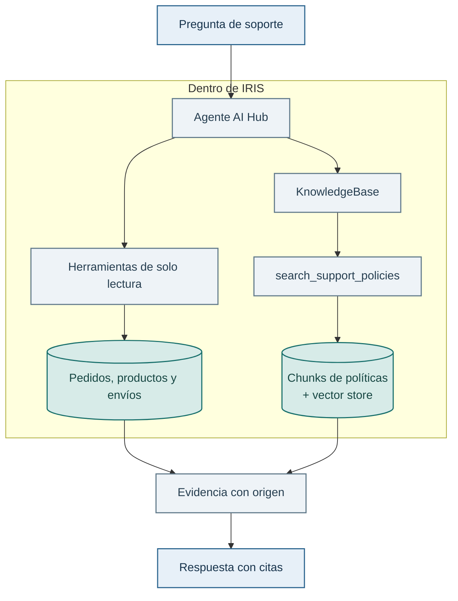
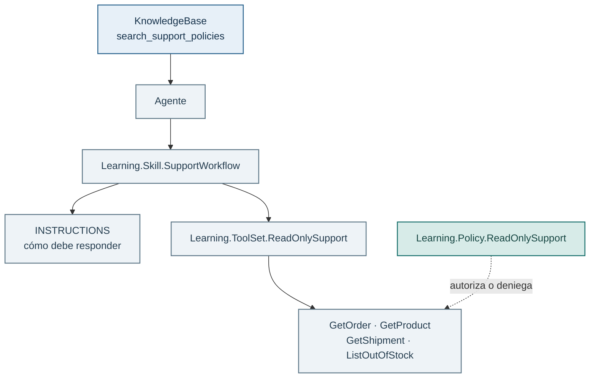

# Lab 05 — RAG nativo con AI Hub

## Objetivo

En los Labs 01 y 02 construiste el RAG de forma explícita. Aquí dejamos que AI
Hub conecte una `KnowledgeBase` con un vector store en IRIS y la añadimos al
agente de soporte. El resultado combina dos clases de evidencia:

- datos vivos y estructurados, obtenidos mediante herramientas de sólo lectura.
- políticas Markdown, recuperadas semánticamente desde la base de conocimiento.



## Antes de empezar

Necesitas haber comprobado las herramientas y la política del
[Lab 04](../04-iris-y-aihub/README.md), con IRIS y los datos demo disponibles.
Para conversar, reutiliza la [configuración de OpenRouter](../../docs/openrouter.md).
No necesitas instalar dependencias Python en `.venv` para este recorrido.

Aquí crearás una base de conocimiento nativa con FastEmbed, distinta de la
tabla vectorial Python del Lab 02. Si saltas directamente a este lab, completa
los requisitos del Lab 04. No necesitas ejecutar los Labs 01–03.

## Recorrido principal: terminal ObjectScript

Este lab construye una `KnowledgeBase` nativa de AI Hub. Jupyter añadiría una
capa Python que no participa en esa operación. Trabajaremos directamente en
la terminal de IRIS, separando el momento de crear el índice —que escribe
estado persistente— de la conversación posterior.

Los embeddings se crean localmente con FastEmbed. Los documentos no se duplican en
ObjectScript: se leen desde `datos-demo/knowledge`, disponible dentro del
contenedor en `/app/datos-demo/knowledge` gracias al volumen de Docker Compose.

Abre o reutiliza una [terminal ObjectScript en USER](../00-setup/README.md#abrir-una-terminal-objectscript).

## De dónde sale `search_support_policies`

En este ejemplo se conserva la búsqueda nativa de AI Hub, pero se amplían
sus resultados para que el agente lea reglas y excepciones juntas:

1. `Learning.Knowledge.SupportRAG.Build()` crea la `KnowledgeBase` nativa con
   FastEmbed y el vector store de IRIS, igual que antes.
2. `Learning.Knowledge.PolicyDocuments` registra la búsqueda nativa en un
   `ToolManager` interno y expone al agente `search_support_policies`.
3. Si el agente indica un `topic` concreto, la herramienta lee directamente
   la política autorizada de ese tema: `garantia`, `devoluciones`, `cancelaciones`,
   `envios`, `cambios` o `productos`. Devuelve un documento completo. Por ejemplo,
   «cancelación de ruido» en la descripción de un producto no debe redirigir una
   consulta de garantía a la política de cancelaciones.
4. Con `topic=general`, la consulta semántica localiza fragmentos y se amplían
   los primeros **dos documentos distintos**, conservando el orden nativo.
5. El agente recibe `text` completo y `metadata.source`, `sourcePath`,
   `retrievalMode=full_document` y `selection=topic` o `semantic`. Sólo la ruta
   semántica añade `matchedChunkId`. `sourceUrl=null` indica un archivo local.

Los documentos son breves (193–305 palabras). Una consulta de garantía debe
recuperar su política completa, incluidos los 12 meses de reacondicionados y
las exclusiones de cobertura. La duración del catálogo no acredita por sí sola
las condiciones de garantía. Ambas variantes del agente reciben esa instrucción.

Esta herramienta se aplica **sólo al agente normal y al agente con skill del
Lab 05**. Los Labs 01–03 usan fragmentos y contexto por secciones. El MCP del
Lab 06 conserva sus cuatro herramientas. La `KnowledgeBase` obtenida con
`Build()` sigue devolviendo fragmentos si se utiliza directamente.

La herramienta sólo permite abrir los seis archivos del corpus versionado.
Una consulta general vacía devuelve una lista vacía y una fuente fuera de esa lista no
permite acceder a archivos arbitrarios. Puedes comprobar la ampliación sin
llamar a un modelo ni escribir en el índice:

```objectscript
Do ##class(Learning.Test.PolicyDocuments).Run()
```

Por eso la política `Learning.Policy.ReadOnlySupport` la autoriza de forma
explícita. Igual que `GetOrder`, pasa por el `ToolManager` y queda auditada.

## Construye, activa el trace y consulta

Primero creamos el agente y añadimos una auditoría de consola. No es un adorno:
AI Hub mostrará cada herramienta que el modelo decide invocar, con sus
argumentos y el resultado. Así podemos comprobar el flujo en vez de fiarnos de
una respuesta que simplemente suena convincente.

```objectscript
Set sc = ##class(Learning.Knowledge.SupportRAG).AddToSupportAgent(.agent)
Do agent.ToolManager.SetAuditPolicy(##class(%AI.Policy.ConsoleAudit).%New())
Set session = agent.CreateSession()
Set response = agent.Chat(session, "¿Qué cubre la garantía de SKU-AUD-001?")
Write response.Content, !
```

La primera vez crea la tabla e índice de la base de conocimiento con FastEmbed,
sin una llamada cloud para los embeddings. Si repites
el ejercicio, usa un nombre de tabla nuevo o limpia deliberadamente el vector
store de práctica: es una escritura persistente, no una comprobación.

## Sigue el recorrido de la respuesta

Antes de leer la respuesta final, mira el trace que aparece en la terminal. En
esta pregunta el agente puede necesitar `GetProduct` para conocer el producto y
`search_support_policies` para recuperar la política. Lo importante no es que
adivine esas herramientas, sino que veas qué decidió usar realmente y qué
evidencia devolvió cada una.

Después, consulta las métricas acumuladas de la sesión:

```objectscript
Set stats = session.GetStats()
Write stats.%ToJSON(), !
```

Busca `total_tool_calls`, los tokens y los tiempos. Si quieres inspeccionar el
historial completo —incluidos mensajes y llamadas a herramientas— puedes ver su
representación JSON:

```objectscript
Set context = session.GetContext()
Write context.%ToJSON(), !
```

`ConsoleAudit` es perfecto para este lab porque trabajamos directamente en la
terminal. No lo uses en el endpoint MCP del Lab 06: escribir en la salida
estándar rompería la respuesta JSON-RPC. Allí la alternativa correcta será una
política de auditoría persistente en IRIS. Este trace tampoco se guarda: si el
caso de uso necesitara trazabilidad real, podríamos crear una política propia
basada en `%AI.Policy.Audit` que registrase en una tabla la herramienta, sus
argumentos, duración y resultado o error.

## Qué observar en la evidencia

No basta con que la respuesta suene razonable. Pide al agente que cite el
documento recuperado y compara esa evidencia con el Markdown original. Si la
pregunta no tiene respaldo, debe reconocerlo en vez de rellenar el hueco.

## Reto

Formula una pregunta que necesite las dos fuentes, por ejemplo una devolución
de un pedido concreto: **«ORD-003 figura como entregado. ¿Puedo devolverlo y
qué plazo tengo?»**

Identifica qué parte procede del pedido en IRIS (su estado) y cuál procede de
la política Markdown (condiciones y plazo de devolución). El estado Delivered
no incluye una fecha real de entrega: la respuesta debe separar el plazo general
de la confirmación de que ese pedido esté dentro del plazo. Los metadatos de los
fragmentos identifican archivos locales, no URLs. Se citan por su nombre sin
inventar un enlace. Ese límite entre herramienta y RAG es justo lo que
conviene poder explicar en producción.

## Ampliación opcional — De agente a skill reutilizable

Hasta ahora has visto de forma explícita la cadena agente → ToolSet → política
→ herramienta. Es la forma más clara de aprenderla. Cuando ese patrón se
repite, AI Hub permite empaquetarlo como una **skill**. En este caso,
`Learning.Skill.SupportWorkflow` reúne tres cosas orientadas al modelo:

- instrucciones en Markdown sobre cómo atender soporte.
- el ToolSet `Learning.ToolSet.ReadOnlySupport`.
- metadatos breves (`SUMMARY`) para describir la capacidad.

Es el equivalente ObjectScript de un `SKILL.md`: una unidad reutilizable de
instrucciones y herramientas. En AI Hub, `UseSkill` registra el catálogo y los
metadatos, pero las instrucciones se cargan de forma progresiva cuando el
modelo invoca `load_skill`. `CreateWithSkill` pide expresamente activar
`support-workflow` antes de atender la consulta. No es un subagente, no crea una sesión distinta
ni recibe permisos propios.

**¿Qué aporta?** Evita repetir el mismo prompt y la selección de herramientas
en cada agente, mantiene reglas como «cita las fuentes recuperadas» en un único
sitio y ayuda a organizar un agente con varias capacidades —por ejemplo,
soporte, analítica y documentación— sin convertir su prompt principal en un
texto enorme. No sustituye a las políticas de seguridad: esas siguen siendo
responsabilidad del ToolSet y de `Learning.Policy.ReadOnlySupport`.



Prueba esta ruta como una **alternativa** a la creación anterior, en una sesión
nueva de IRIS. No hace falta añadirla al agente que ya tenías. La base de
conocimiento se añade después exactamente igual y genera
`search_support_policies`:

```objectscript
Set sc = ##class(Learning.Knowledge.SupportRAG).AddToSupportAgentWithSkill(.agent)
Do $System.Status.DisplayError(sc)
Write agent.ToolManager.GetToolStatuses().%ToJSON(), !

Do agent.ToolManager.SetAuditPolicy(##class(%AI.Policy.ConsoleAudit).%New())
Set session = agent.CreateSession()
Set response = agent.Chat(session, "ORD-003 figura como entregado. ¿Puedo devolverlo y qué plazo tengo?")
Write response.Content, !
```

Después de la conversación puedes comprobar la activación:

```objectscript
Write session.ActiveSkills.%ToJSON(), !
```

Debe aparecer `Learning.Skill.SupportWorkflow`. Que las herramientas estén
registradas en el catálogo no demuestra por sí solo que se hayan cargado las
instrucciones de la skill.

El catálogo debe mostrar las mismas herramientas de pedido, producto y envío,
y `search_support_policies` aparecerá al añadir la base de conocimiento. En el
trace comprueba que la pregunta combina `GetOrder` con la búsqueda de políticas
y que la respuesta cita la evidencia.

Lo que cambia es cómo se empaquetan y se reutilizan las instrucciones y el
ToolSet. Se mantienen la búsqueda con ampliación a documentos completos, las
fuentes Markdown, la política `Learning.Policy.ReadOnlySupport` y los permisos: la
skill no concede acceso adicional. Para comprobarlo, intenta una escritura
como en el Lab 04. La política debe seguir denegándola. AI Hub también puede
cargar skills desde otros orígenes en escenarios más avanzados, pero aquí la
dejamos deliberadamente como una clase interna y fácil de inspeccionar.
