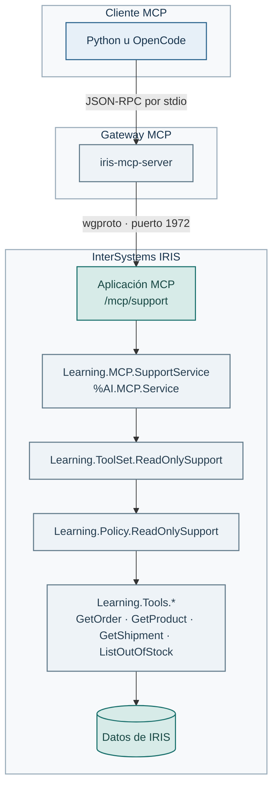

# Lab 06 — Publicar herramientas de AI Hub mediante MCP

## Objetivo

En este lab sacamos las herramientas de soporte de IRIS para que las use otro
cliente o agente mediante **MCP** (*Model Context Protocol*). No creamos una
segunda lógica para MCP: publicamos el mismo `ToolSet` de sólo lectura que ya
usaste en el Lab 04, con la misma política de seguridad.

El recorrido es deliberadamente comprobable: primero instalamos el endpoint en
IRIS, después un cliente Python lista el catálogo real y, por último, conectamos
OpenCode a ese mismo servidor usando la clave OpenRouter del alumno.

## Las piezas y el recorrido de una llamada



`iris-mcp-server` es el gateway incluido con IRIS. Habla MCP con el cliente y
el protocolo nativo `wgproto` con IRIS. No tienes que escribir un servidor MCP
en Python. Dentro de IRIS, `Learning.MCP.SupportService` enlaza el endpoint con
`Learning.ToolSet.ReadOnlySupport`. La política sigue ejecutándose antes de
cada herramienta: MCP no convierte una operación en segura por arte de magia.

Hay dos credenciales distintas:

- `IRIS_MCP_GATEWAY_*`: el gateway se identifica ante IRIS. En el contenedor
  local recién creado se usa `CSPSystem` con la contraseña de fábrica `SYS`.
  Una contraseña vacía no autentica la conexión.
- `MCP_SUPPORT_*`: el gateway se identifica ante la aplicación `/mcp/support`.

El segundo usuario sólo recibe `SELECT` sobre las tablas necesarias. Para el
entorno local del curso es `mcp-user` con contraseña `test`. No reutilices esas
credenciales fuera de Docker.


## Antes de empezar

Necesitas IRIS y los datos demo del [Lab 00](../00-setup/README.md), y conocer
el ToolSet y la política del [Lab 04](../04-iris-y-aihub/README.md).
El RAG del Lab 05 no es un requisito: MCP publicará las cuatro herramientas
estructuradas de soporte.

En este lab instalarás el endpoint MCP y las dependencias de su cliente Python.
Reutiliza `.venv` y `.env`. Comprueba que `IRIS_MCP_GATEWAY_*` y `MCP_SUPPORT_*`
están configuradas como se explica arriba. Si acabas de cambiarlas, sigue
[las indicaciones del Lab 00 para aplicar cambios al contenedor](../00-setup/README.md#retomar-el-curso-en-otra-sesión).
El catálogo y las llamadas de comprobación no necesitan OpenRouter.

## 1. Prepara el endpoint en IRIS

Este lab usa directamente ObjectScript porque la aplicación MCP, el usuario y
sus permisos viven en IRIS. Abre o reutiliza una
[terminal ObjectScript en USER](../00-setup/README.md#abrir-una-terminal-objectscript).

Ahora comprueba las clases e instala de forma explícita el endpoint. `Install()`
crea o actualiza tanto el usuario como la aplicación `/mcp/support`, así que es
seguro repetirlo en este entorno de práctica.

```objectscript
Do ##class(Learning.MCP.Setup).Check()
Set sc = ##class(Learning.MCP.Setup).Install()
Do $System.OBJ.DisplayError(sc)
Do ##class(Learning.Test.Support).Run()
```

En el Management Portal puedes inspeccionarlo en **System Administration →
Security → Applications → MCP Servers**. Verás `/mcp/support`, namespace
`USER`, dispatch class `Learning.MCP.SupportService` y autenticación por
contraseña.

## 2. Valida primero desde Python

Antes de delegar nada en OpenCode, usa un cliente MCP mínimo que haga `tools/list`.
No llama a OpenRouter ni a un LLM: sólo confirma qué capacidades publica de verdad
el endpoint.

Desde la raíz del proyecto, activa el entorno virtual si abres una terminal
nueva. Instala el extra MCP una sola vez. Después puedes repetir sólo las pruebas:

```bash
source .venv/bin/activate
python -m pip install -r requirements-mcp.txt
python scripts/test_mcp_support.py
# Comprueba también las llamadas reales. Requiere los datos demo del Lab 00.
python scripts/test_mcp_support.py --call-tools
```

La salida debe listar únicamente `GetOrder`, `GetProduct`, `GetShipment` y
`ListOutOfStock` (pueden llevar un prefijo técnico del endpoint). Si aparece
una herramienta de escritura, o falta una de esas cuatro, no continúes: revisa
el `ToolSet` y la política antes de conectarlo a un agente.

La opción `--call-tools` consulta un pedido, un producto, su envío y el stock
con las cuatro herramientas publicadas. Detecta errores de ejecución y de
políticas que un catálogo correcto por sí solo no revela. No llama a un LLM.

El script usa [`mcp/aihub-support.toml`](../../mcp/aihub-support.toml). Ese
archivo configura el **gateway** y resuelve las contraseñas desde el entorno
del contenedor. No guarda secretos en Git.

## 3. Consulta desde OpenCode con tu clave de OpenRouter

Este es el recorrido con modelo del lab. Todo se ejecuta en la máquina del
curso: en EC2, usa SSH o la terminal remota de VS Code. Cada alumno utiliza
su propio contenedor `iris-aihub`, sus datos y la clave que le entrega el instructor.
Esta parte se ejecuta desde terminal, sin instalar extensiones de VS Code.

### Preparar una vez

En la máquina preparada por el instructor, OpenCode ya está instalado.
Comprueba la versión desde la terminal de esa máquina:

```bash
opencode --version
```

La versión comprobada para el curso es `1.19.5`. No necesitas instalar ni
actualizar OpenCode durante el lab. Si el comando no existe o muestra otra
versión, avisa al instructor para revisar la preparación del entorno.

Guarda tu clave en `OPENROUTER_API_KEY` del `.env` de la máquina del curso, igual que en los labs
anteriores. `OPENROUTER_MODEL` selecciona el modelo. El predeterminado sigue
siendo `openai/gpt-oss-20b`. Para esta consulta el cliente lee `.env` directamente:
si sólo cambias la clave del cliente, no necesitas recrear IRIS.

### Preguntar y observar las herramientas

Con `.venv` activo, desde la raíz del repositorio:

```bash
python scripts/test_mcp_support.py --ask "¿Dónde está ORD-002?"
```

La opción `--ask` **consume créditos de OpenRouter**. El mismo script, sin esa
opción, sigue comprobando MCP sin llamar a un modelo. Ahora actúa como lanzador:
carga `.env` y ejecuta el CLI real `opencode run`. OpenCode mantiene la conversación,
descubre las herramientas MCP y decide cuáles invocar. Python no elige las llamadas.

El lanzador pasa la configuración mediante `OPENCODE_CONFIG_CONTENT`: proveedor
OpenRouter y gateway `docker exec -i iris-aihub ... --config /app/mcp/aihub-support.toml run`.
Habilita las herramientas `aihub_support_*` y deniega las demás, para que esta
consulta use los datos del endpoint. No escribe la clave en archivos de
configuración de OpenCode ni requiere registrar el servidor en una configuración personal.
Puedes inspeccionar ese bloque en `ask_with_opencode()` dentro del script.

Para ver el registro completo de eventos y conservarlo:

```bash
mkdir -p tmp
python scripts/test_mcp_support.py --ask "¿Dónde está ORD-002?" --json > tmp/opencode-pedido.jsonl
```

Comprueba las llamadas, no sólo la respuesta final:

1. `GetOrder` debe recibir `orderRef=ORD-002`.
2. Después, `GetShipment` debe recibir `trackingNumber=DHL-1002`, obtenido del pedido.
3. Sus resultados deben indicar `Shipped`, `InTransit` y el último evento de Madrid.
4. La respuesta debe apoyarse en esos resultados y no inventar una fecha real de entrega.

En los eventos JSON, localiza `type=tool_use`, el nombre de la herramienta y
su estado, argumentos y resultado. Los nombres llevan el prefijo del MCP.
`tools/list` confirma que las herramientas existen. Estos eventos permiten
comprobar que el modelo las ha utilizado. Si falta una llamada, el ejercicio
no queda validado sólo porque la respuesta final parezca correcta.

Prueba también una consulta de producto:

```bash
python scripts/test_mcp_support.py --ask "Consulta SKU-AUD-001 y dime su precio y stock."
```

Deberías observar `GetProduct`, con el SKU solicitado, y una respuesta basada
en su resultado. Las herramientas son las mismas que probaste sin LLM.

La configuración usa las opciones documentadas de [OpenCode CLI](https://opencode.ai/docs/cli/),
[MCP](https://opencode.ai/docs/mcp-servers/) y [permisos](https://opencode.ai/docs/permissions/).

### Opcional: usar directamente los comandos de OpenCode

Puedes repetir la consulta sin el lanzador Python. Ejecuta los comandos en la
máquina del curso, desde `/home/ubuntu/curso-ia-asistentes-iris` si utilizas EC2.
IRIS debe estar en ejecución y el endpoint MCP instalado según los pasos anteriores.

**Configura OpenRouter una vez:**

```bash
opencode auth login
```

Selecciona **OpenRouter** e introduce tu clave individual. OpenCode la guarda
en `~/.local/share/opencode/auth.json`, fuera del repo. El lanzador Python
anterior sigue utilizando la clave del `.env`. Si cambias una de estas claves,
comprueba qué configuración usa el cliente que estás ejecutando.

**Registra el MCP una vez:**

```bash
opencode mcp add
```

En el asistente selecciona la configuración del proyecto, nombre
`aihub_support` y tipo **local**. Introduce este comando:

```bash
docker exec -i iris-aihub /usr/irissys/bin/iris-mcp-server --config /app/mcp/aihub-support.toml run
```

OpenCode guardará la configuración del MCP para reutilizarla. El gateway se
ejecuta dentro del contenedor y usa sus variables de entorno para autenticarse
en IRIS. No necesitas abrir un puerto MCP en Internet.

**Deja el archivo `opencode.json` completo así:**

Abre `opencode.json` en la raíz del repo, junto a `docker-compose.yml`.
En EC2, la ruta es `/home/ubuntu/curso-ia-asistentes-iris/opencode.json`.
Si el asistente sólo ha creado el bloque `mcp` de este ejercicio, sustituye
su contenido por el siguiente JSON completo y guarda el archivo:

```json
{
  "mcp": {
    "aihub_support": {
      "type": "local",
      "command": [
        "docker",
        "exec",
        "-i",
        "iris-aihub",
        "/usr/irissys/bin/iris-mcp-server",
        "--config",
        "/app/mcp/aihub-support.toml",
        "run"
      ],
      "enabled": true
    }
  },
  "permission": {
    "*": "deny",
    "aihub_support_*": "allow"
  },
  "autoupdate": false
}
```

`mcp` registra y habilita el gateway. `permission` autoriza únicamente las
herramientas `aihub_support_*`, igual que el lanzador Python. `autoupdate`
desactiva las actualizaciones automáticas para conservar la versión del curso.

Si ya tenías otros servidores o ajustes propios en ese archivo, consérvalos
al incorporar esta configuración. Si el asistente ha creado `opencode.jsonc`,
edita ese archivo en lugar de crear un segundo archivo de configuración.
No guardes la API key aquí. `opencode auth login` la guarda por separado.

**Comprueba la conexión sin generar una respuesta:**

```bash
opencode mcp list
```

Debe mostrar `aihub_support` conectado. Esto comprueba la conexión MCP y no
llama al modelo de generación.

**Pregunta directamente:**

```bash
opencode run --model openrouter/openai/gpt-oss-20b \
  "Responde en español usando las herramientas MCP aihub_support. Consulta ORD-002 con GetOrder y después GetShipment con el tracking obtenido. Indica dónde está y no inventes fechas."
```

Para consultar un producto y ver los eventos JSON:

```bash
opencode run --model openrouter/openai/gpt-oss-20b --format json \
  "Usa aihub_support para consultar SKU-AUD-001 con GetProduct y dime su precio y stock."
```

Estas consultas **consumen créditos de OpenRouter**. El modelo se indica
explícitamente con `--model`. Si lo cambias en `.env`, ajusta también estos
comandos. Comprueba las llamadas y los resultados como en el ejercicio anterior.
Esta variante queda pendiente de validación en el piloto. Registrar el MCP o
recibir una respuesta no demuestra por sí solo que el modelo haya usado las
herramientas esperadas.

## Problemas frecuentes

- **ImportError con `eval_type_backport`**: ocurre con el antiguo `mcp==1.2.0`
  y versiones recientes de Pydantic, antes de conectar con IRIS. Actualiza
  `requirements-mcp.txt` desde la copia actual del curso y reinstala con
  `python -m pip install --upgrade -r requirements-mcp.txt`. La versión fijada
  ahora es `mcp==1.30.0`. Comprueba también que el entorno del curso usa
  Python 3.11, 3.12 o 3.13 según el Lab 00.
- **401 Unauthorized**: comprueba `MCP_SUPPORT_USER` y
  `MCP_SUPPORT_PASSWORD`. No son las credenciales del gateway.
- **Sólo aparece `iris_status` o no se listan herramientas**: confirma que
  `Install()` terminó sin error y que la dispatch class es
  `Learning.MCP.SupportService`.
- **El catálogo no se actualiza tras editar el ToolSet**: recompila las clases,
  ejecuta de nuevo `Install()` y repite la consulta desde OpenCode.
- **JSON-RPC inválido**: no añadas `%AI.Policy.ConsoleAudit` a este ToolSet.
  Escribir en la salida estándar rompería el protocolo MCP.

## Ideas para explorar por tu cuenta

Si quieres profundizar, puedes pedir a OpenCode que cree un pedido usando
`--ask` y observar cómo responde al no disponer de esa herramienta o recibir una
denegación. Es una propuesta opcional y no forma parte de una entrega
obligatoria. La consulta consume créditos de OpenRouter.

También puedes explorar la segunda barrera en
`Learning.Policy.ReadOnlySupport`: la seguridad no depende de que el modelo
“se porte bien”, sino de la superficie publicada y la política que la protege.
