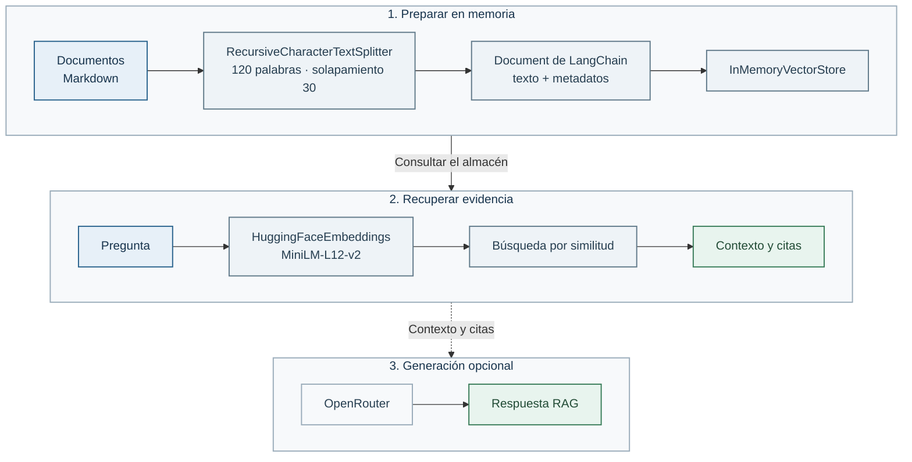

# Ampliación: el mismo RAG con LangChain

En el Lab 01 construiste cada pieza del flujo a mano con `learning_ai_rag`. Aquí repetimos la idea usando LangChain para comparar. No es un laboratorio necesario para seguir el curso: sirve para decidir con criterio cuándo un framework compensa.



## Qué vas a comparar

LangChain aporta objetos y conectores listos para usar: `Document`, `RecursiveCharacterTextSplitter`, `HuggingFaceEmbeddings`, `InMemoryVectorStore` y, si quieres, `ChatOpenAI`. Pero las decisiones importantes siguen siendo tuyas: las fuentes, el tamaño de los chunks, el umbral de evidencia, las citas y cuándo abstenerse.

Para que la comparación sea justa, el notebook mantiene el objetivo de 120 palabras y 30 de solapamiento. No reutiliza `learning_ai_rag`: carga los Markdown con unas pocas líneas visibles y deja que LangChain cree los chunks y conserve sus metadatos de procedencia.

## Antes de empezar

Necesitas el [entorno Python del Lab 00](../../00-setup/README.md#entorno-python-para-los-labs-0103) y los conceptos del [Lab 01](../../01-python-rag-basico/README.md). IRIS no interviene en esta ampliación. Reutiliza `.venv` y, para generar, la [configuración de OpenRouter](../../../docs/guia-acceso-aws-alumno.md#4-añade-tu-clave-y-arranca-iris).

Desde la raíz, activa el entorno e instala sólo el extra de LangChain una vez:

```bash
source .venv/bin/activate
python -m pip install -r requirements-langchain.txt
```

## Recorrido principal: notebook

Abre [rag_langchain.ipynb](rag_langchain.ipynb) en VS Code y selecciona el kernel de `.venv`. Verás por separado documentos, chunks, embeddings, almacén en memoria, resultados con puntuación y contexto. Nada se guarda en IRIS ni en disco: el almacén desaparece al terminar el kernel.

La clase `ChatOpenAI` es el nombre técnico del conector compatible: en este notebook se conecta explícitamente a OpenRouter. No necesita credenciales de otro proveedor. `OPENROUTER_MODEL` selecciona el modelo, con GPT-OSS 20B por defecto.

La última celda ofrece generación opcional. Para activarla, añade `OPENROUTER_API_KEY` a `.env`. Sin clave, todo el recorrido de recuperación sigue siendo útil.

## La idea que conviene llevarse

Un framework reduce código de integración, pero no convierte automáticamente una búsqueda en un buen RAG. La calidad de las fuentes y la evidencia recuperada siguen mandando. Si la puntuación no supera el umbral, el ejemplo no llama al modelo: se abstiene antes de que pueda rellenar huecos con imaginación.
