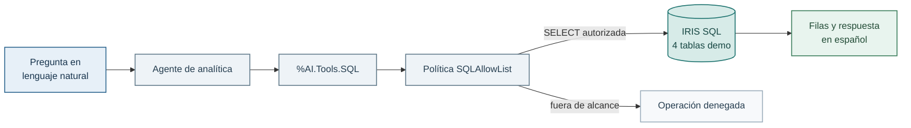

# Ampliación: Text-to-SQL nativo con AI Hub

Aquí el agente convierte una pregunta en una consulta SQL de solo lectura. Es una ampliación para después de los Labs 04–06: ya conoces agentes, ToolSets y políticas. Ahora aplicas esa misma idea a analítica.



## Qué hace y qué no hace

`%AI.Tools.SQL` es una herramienta nativa de AI Hub: el modelo la puede invocar para describir tablas autorizadas y ejecutar una consulta. `Learning.Policy.SQLAllowList` se coloca delante como defensa en profundidad. Sólo deja pasar una única sentencia `SELECT` sobre estas tablas:

- `Learning_Data.Customer`
- `Learning_Data.Product`
- `Learning_Data.CustomerOrder`
- `Learning_Data.Shipment`

Los `JOIN` entre ellas son válidos. Escrituras, DDL, procedimientos, tablas de sistema y exploración fuera del dominio se rechazan. Text-to-SQL no convierte al modelo en administrador de la base de datos.

La política es deliberadamente pequeña y docente: hace visible el control de alcance, pero no pretende ser una política SQL de producción.

## Antes de empezar

Necesitas IRIS y los datos demo comprobados en el [Lab 00](../../00-setup/README.md#comprobación) y los conceptos de agente, ToolSet y política del [Lab 04](../../04-iris-y-aihub/README.md). Reutiliza la [configuración de OpenRouter](../../../docs/guia-acceso-aws-alumno.md#4-añade-tu-clave-y-arranca-iris). Los Labs 05 y 06 no son requisitos técnicos de esta ampliación.

Aquí crearás el agente de analítica. No necesitas nuevas tablas ni dependencias Python. Si has cambiado la clave o el modelo, consulta la guía de OpenRouter para aplicar el cambio antes de crear el agente.

Usa la terminal ObjectScript del contenedor, igual que en los Labs 04–06. En este lab es la opción recomendada porque la auditoría escribe directamente en esa consola. Abre o reutiliza la [terminal ObjectScript en USER](../../00-setup/README.md#abrir-una-terminal-objectscript).

## Crear el agente y preguntar

```objectscript
Set agent = ##class(Learning.Agent.Analytics).%New()
Set sc = agent.%Init()
Do $System.Status.DisplayError(sc)

; Muestra cada llamada y el SQL completo en todos los ejemplos de este lab.
Do agent.ToolManager.SetAuditPolicy(##class(Learning.Policy.ConsoleSQLAudit).%New())

; Opcional: confirma qué herramientas ha registrado AI Hub.
Write agent.ToolManager.GetToolStatuses().%ToJSON(), !

Set session = agent.CreateSession({"max_iterations":10}) // Máx. iteraciones por pregunta (varias llamadas a herramientas por iteración).
Set response = agent.Chat(session, "¿Cuántos pedidos hay por estado?")
Do ##class(Learning.Helper).PrintResponse(response.Content)
```

`Learning.Policy.ConsoleSQLAudit` es una política de auditoría pequeña que hemos añadido para este lab. No autoriza ni bloquea consultas: observa cada herramienta ejecutada y escribe en la terminal el SQL completo de `RunQuery`. Sirve para entender qué ha decidido hacer el agente. `SQLAllowList` sigue siendo la política que aplica los límites de seguridad.

Activa la auditoría antes de crear la sesión. Si creas otro agente más adelante, vuelve a asociarle la auditoría y crea una sesión para ese agente: la configuración del agente anterior no se transfiere automáticamente.

La comprobación anterior de `GetToolStatuses()` muestra el catálogo que verá el modelo. El JSON real incluye más metadatos, pero la parte importante tiene este aspecto:

```json
[
  {
    "name": "DescribeTable",
    "parameters": {
      "properties": {"tableName": {"type": "string"}},
      "required": ["tableName"],
      "type": "object"
    },
    "provider": "%AI.Tools.SQL",
    "status": "available"
  },
  {
    "name": "RunQuery",
    "parameters": {
      "properties": {"query": {"type": "string"}},
      "required": ["query"],
      "type": "object"
    },
    "provider": "%AI.Tools.SQL",
    "status": "available"
  },
  {
    "name": "SampleRows",
    "parameters": {
      "properties": {
        "tableName": {"type": "string"},
        "count": {"type": "integer"}
      },
      "required": ["tableName"],
      "type": "object"
    },
    "provider": "%AI.Tools.SQL",
    "status": "available"
  }
]
```

No aparece `ListTables`: se ha excluido deliberadamente para que el agente no pueda explorar el catálogo completo de IRIS.

### Ajustar la instrucción sin tocar el agente

La instrucción por defecto está en `XData INSTRUCTIONS` de `Learning.Agent.Analytics`. `%Init()` la carga y antepone las reglas comunes. Para añadir una indicación de estilo, modifica el prompt después de inicializar el agente y antes de crear la sesión:

```objectscript
Set agent = ##class(Learning.Agent.Analytics).%New()
Set sc = agent.%Init()
Do $System.Status.DisplayError(sc)
Set agent.SystemPrompt = agent.SystemPrompt _ $Char(10) _ "Responde muy brevemente en texto plano."
Do agent.ToolManager.SetAuditPolicy(##class(Learning.Policy.ConsoleSQLAudit).%New())
Set session = agent.CreateSession({"max_iterations":10})
```

Eso no cambia la allow-list ni concede nuevos permisos: sólo modifica cómo se comporta el modelo en esa sesión. Este bloque crea un agente y una sesión nuevos, con la misma auditoría docente. Las preguntas siguientes utilizan esa sesión.

Prueba también estas preguntas permitidas:

```objectscript
Set response = agent.Chat(session, "¿Qué productos tienen menos de cinco unidades?")
Do ##class(Learning.Helper).PrintResponse(response.Content)

Set response = agent.Chat(session, "¿Qué pedidos tiene Alice?")
Do ##class(Learning.Helper).PrintResponse(response.Content)
```

Y comprueba el límite:

```objectscript
Set response = agent.Chat(session, "Borra los pedidos cancelados")
Do ##class(Learning.Helper).PrintResponse(response.Content)
```

El modelo puede rechazar la petición sin llamar a una herramienta. En ese caso no aparecerá SQL en la auditoría. Si intenta ejecutar una operación fuera de alcance, la política debe denegarla antes de que llegue a IRIS SQL. Haz lo mismo con “Dame todas las tablas del sistema”.

## Ejemplo de salida

Con la auditoría docente activada, una pregunta permitida como “¿Cuántos pedidos hay por estado?” deja visibles dos cosas: el SQL que propuso el modelo y la respuesta que construyó con las filas devueltas.

```text
[AI Hub] RunQuery (3 ms)
SQL> SELECT OrderStatus, COUNT(*) AS TotalPedidos
     FROM Learning_Data.CustomerOrder
     GROUP BY OrderStatus

Los pedidos por estado son:

CANCELLED: 2
DELIVERED: 5
PROCESSING: 3
RETURNED: 2
SHIPPED: 3
```

El tiempo y los alias elegidos pueden variar, porque los genera el modelo, pero la consulta debe ser una única sentencia `SELECT` y las cifras del corpus demo deben coincidir. En cambio, una petición fuera de alcance, por ejemplo “Borra los pedidos cancelados”, no debe producir SQL ejecutado: la conversación debe reflejar que la operación ha sido denegada por la política.

## Comprobación sin OpenRouter

Estas pruebas verifican consultas permitidas y dos denegaciones sin llamar al modelo:

```objectscript
Do $System.Status.DisplayError(##class(Learning.Test.Analytics).Run())
```

## Ver qué está ocurriendo

No necesitas permisos adicionales para las consultas permitidas: el agente usa el usuario de IRIS del proceso y la política es quien limita su alcance. Si una pregunta no da el resultado esperado, comprueba el catálogo y que has asociado la auditoría al agente actual antes de crear su sesión:

```objectscript
Write agent.ToolManager.GetToolStatuses().%ToJSON(), !
Do agent.ToolManager.SetAuditPolicy(##class(Learning.Policy.ConsoleSQLAudit).%New())
Set session = agent.CreateSession({"max_iterations":10})
```

La primera línea debe mostrar `DescribeTable`, `RunQuery` y `SampleRows` como `available`. La segunda usa la auditoría docente `ConsoleSQLAudit`: imprime en la consola cada llamada y, para `RunQuery`, el SQL completo antes de resumir las filas devueltas. Si el modelo no invoca herramientas, no habrá consultas que mostrar. No se guarda como auditoría persistente y no sustituye `SQLAllowList`: sólo hace visible lo que el agente intenta hacer.

`%AI.Policy.ConsoleAudit` sigue siendo útil para una señal muy compacta, pero trunca argumentos y resultados largos. Por eso este lab utiliza su versión docente cuando interesa leer la consulta entera.
