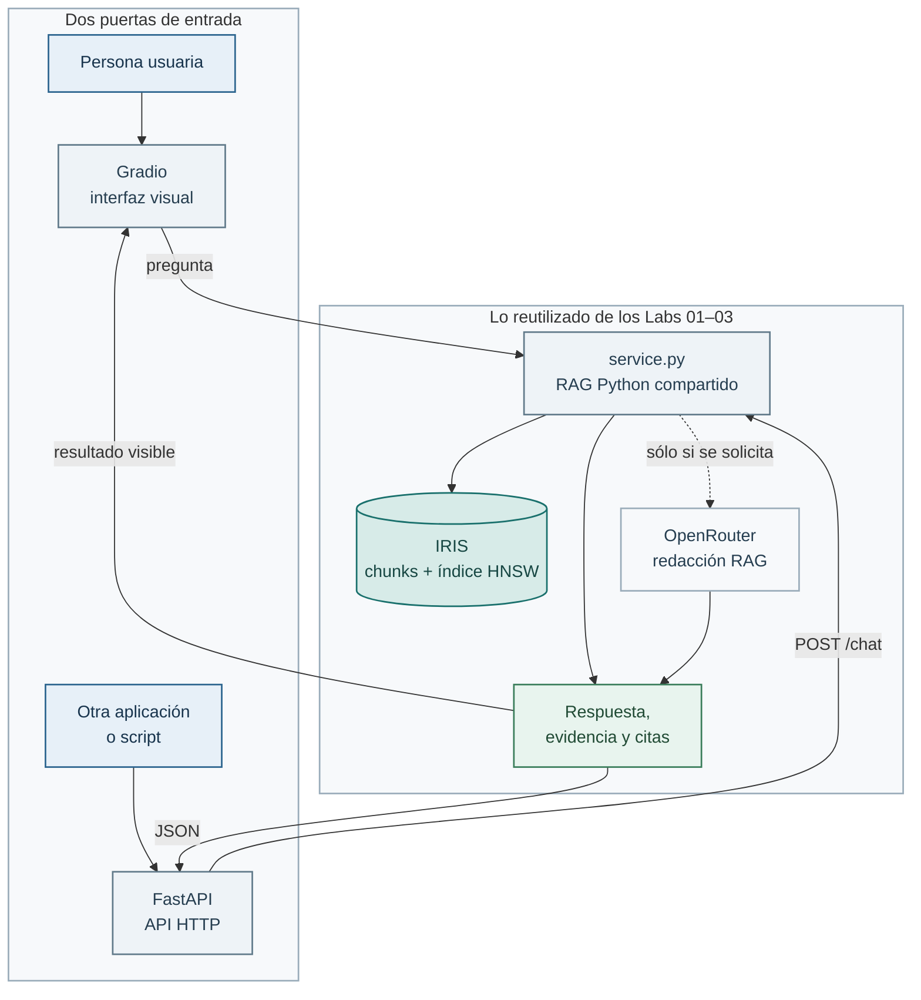
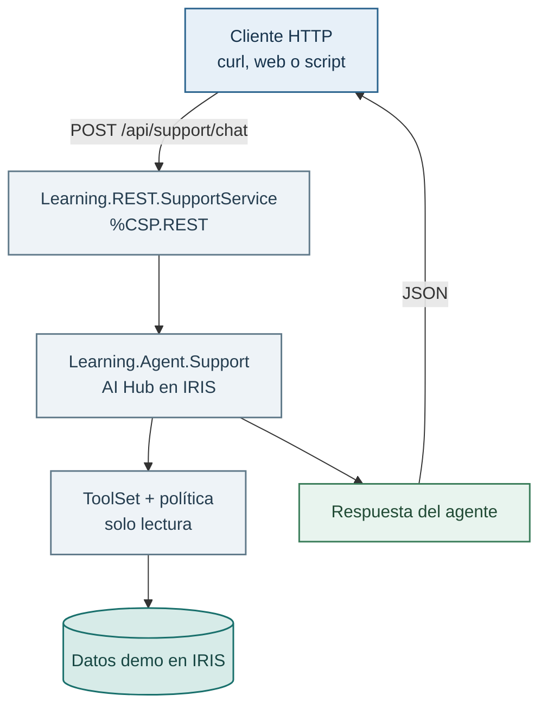

# Ampliación opcional — Una UI pequeña para el RAG

## Objetivo

Hasta ahora has construido y evaluado un RAG desde un notebook y desde la
terminal. Aquí no cambiamos cómo recupera información: añadimos una forma más
cómoda de usarlo. La interfaz muestra la respuesta y, debajo, los chunks
recuperados con sus citas.

No crea tablas ni carga documentos. Consulta de forma read-only el vector store
persistente del Lab 02. Por eso debes haber completado ese lab antes.

## Antes de añadir capas: qué ya tenías

El Lab 02 dejó preparado el corpus persistente en IRIS y el Lab 03 comprobó
que recupera las fuentes esperadas. `service.py` reutiliza exactamente ese
trabajo: recibe una pregunta, crea su embedding, busca los chunks en IRIS con
`RAGPipeline` y devuelve evidencia trazable. No carga documentos, no crea
índices y no sustituye la evaluación.

Sobre ese mismo servicio se ofrecen dos puertas de entrada independientes:

- **Gradio** es la interfaz visual de esta ampliación y su recorrido principal.
  Sirve para que una persona converse con el RAG desde el navegador.
- **FastAPI** no pinta pantallas. Publica el mismo servicio mediante HTTP para
  que otra aplicación, una web futura o un script pueda hacer `POST /chat`.

Gradio y FastAPI **no se llaman entre sí**. Los dos reutilizan `service.py`.
Por eso dan el mismo resultado y no duplican la lógica RAG.



## Qué aporta cada fichero

- `service.py`: el núcleo compartido. Aquí sigue estando el flujo RAG que
  aprendiste antes: embedding de la pregunta, búsqueda vectorial y citas.
- `app.py`: la capa Gradio. Recibe texto del navegador, llama a `service.py` y
  presenta conversación y evidencia. Es la parte que ejecutarás primero.
- `api.py`: la capa FastAPI. Expone `service.py` como `POST /chat`, con un JSON
  de entrada y otro de salida. Es útil para integrar el RAG sin copiarlo.

## Antes de empezar

Necesitas el corpus y el índice HNSW del [Lab 02](../../02-sql-vector-search/README.md),
con IRIS arrancado. Reutiliza `.venv` y la conexión de `.env` del
[Lab 00](../../00-setup/README.md). Para generar, reutiliza también la
[configuración de OpenRouter](../../../docs/guia-acceso-aws-alumno.md#4-añade-tu-clave-y-arranca-iris).

Aquí añadirás una interfaz al RAG existente. No necesitas preparar agentes
AI Hub ni instalar el adaptador REST opcional para usar Gradio o FastAPI.
Activa el entorno e instala sólo el extra de UI una vez:

```bash
source .venv/bin/activate
python -m pip install -r requirements-ui.txt
```

Comprueba que el corpus de Lab 02 existe. Si este comando indica que falta
la tabla, el índice o el corpus, vuelve al Lab 02 y completa sólo lo que falte:

```bash
python labs/02-sql-vector-search/vector_search.py --question "¿Qué plazo hay para devolver un producto?"
```

## Recorrido principal: Gradio

Arranca la aplicación desde la raíz del repositorio:

```bash
python labs/opcionales/ui-asistente/app.py
```

Abre la URL local que indica Gradio y prueba, por ejemplo:

> ¿Puedo devolver un pedido ya entregado y qué plazo tengo?

Primero deja desmarcada **Generar con OpenRouter**. Verás que la aplicación recupera
evidencia, pero no pretende redactar una respuesta de LLM. Abre el acordeón y
lee los chunks: esa es la parte que conviene comprobar antes de confiar en una
respuesta.

Si defines `OPENROUTER_API_KEY` en `.env`, marca la casilla y vuelve a preguntar.
Entonces `RAGPipeline` pasa sólo esa evidencia al modelo para redactar la
respuesta RAG. Sin clave, el resto de la UI sigue siendo útil.

## El mismo flujo como API

FastAPI es una segunda forma de consumir el mismo `service.py`, útil para ver
un contrato HTTP sencillo. Arráncalo en otra terminal:

```bash
uvicorn api:app --app-dir labs/opcionales/ui-asistente --reload
```

Abre `http://127.0.0.1:8000/docs`: FastAPI crea una página para probar el
contrato sin escribir un cliente. Los archivos de Swagger se sirven desde tu
entorno virtual, no desde un CDN: la documentación funciona aunque la red no
permita descargar recursos externos. También puedes usar `curl`:

```bash
curl -X POST http://127.0.0.1:8000/chat \
  -H 'Content-Type: application/json' \
  -d '{"question":"¿Qué garantía tiene un producto reacondicionado?"}'
```

La respuesta contiene `answer`, `citations`, `abstained` y `generated`. El
campo `generate` es `false` por defecto. Envía `true` sólo si has configurado
la clave OpenRouter.

## Adaptador REST de AI Hub (opcional para quien quiera curiosear)

La UI anterior habla con el RAG Python, que es suficiente para esta ampliación.
El adaptador REST enseña una alternativa distinta: cómo publicar por HTTP la
funcionalidad de un agente que vive directamente en IRIS.

`Learning.REST.SupportService` es un servicio `%CSP.REST`. Recibe un
`POST /chat` con una pregunta en JSON, crea el `Learning.Agent.Support` que
construiste en los Labs 04–05, abre una sesión y llama a `agent.Chat()`. La
respuesta del agente vuelve como JSON. Por tanto, no añade otro agente ni otra
lógica de negocio: es una capa fina que traduce entre HTTP y el agente AI Hub.



Esto sirve para visualizar una arquitectura habitual: una interfaz no necesita
saber cómo se crean sesiones, se aplican políticas o se llaman herramientas.
Sólo conoce un contrato HTTP. En esta primera versión la ruta REST responde
con el texto del agente y no incorpora citas RAG. Es una alternativa para
experimentar con una UI sobre AI Hub, no un requisito de esta ampliación ni un
sustituto del recorrido principal.

Para registrarlo explícitamente en tu IRIS local:

```objectscript
USER>Set sc = ##class(Learning.REST.Setup).Install()
USER>Do $System.Status.DisplayError(sc)
```

`Install()` configura la aplicación CSP como **Unauthenticated** y le asigna el
rol de aplicación `%All`. Es lo que permite probar el endpoint con `curl` sin
añadir credenciales en esta demostración local. Después, con `OPENROUTER_API_KEY`
configurada y el contenedor reiniciado, prueba:

```bash
curl -X POST http://localhost:52773/api/support/chat \
  -H 'Content-Type: application/json' \
  -d '{"question":"¿Dónde está ORD-002?"}'
```

Este endpoint es sólo para el Docker local del curso. No incorpora
autenticación, rate limiting ni observabilidad de producción. No lo expongas a
una red compartida.
